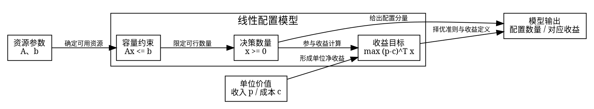

# 从真实研究材料生成论文图

此指南用于选图、代码生成及视觉验收。共享硬规则和阶段触发只维护在 [证据规则](../../../../workflow/rules/evidence.md#代码生图与图登记)，图登记字段只维护在 [记录模板](../../../../workflow/templates/records.md)。以下代码是可改用的表达示例，不是研究结果；仅在取得对应真实材料时用于正式论文。

## 好图先回答一个读者问题

| 读者需要理解 | 适合的表达 | 必须守住的依据与边界 |
|---|---|---|
| 数据分布、异常或组间差异 | 直方/箱线/散点；必要时分面 | 写清样本、单位、分组；异常标记不等于删除理由，相关不等于因果 |
| 为什么选择一个候选 | 统一条件下的指标/成本比较或方案结构图 | 只能使用实际试跑；未试跑候选可做结构比较，不能编造性能 |
| 参数改变时结论是否稳定 | 参数—指标曲线或参数—方案变化图 | 先有真实参数扫描和可信范围；指标平稳不自动说明具体方案不变 |
| 样本/情景扰动影响多大 | 分布、区间或情景比较图 | 来源、情景、统计口径和重复次数真实；误差条必须说明含义 |
| 不利情景可能损失什么 | 收益—风险、尾部损失或后悔值图 | 使用实际风险实验，不能由平均值臆造尾部风险 |
| 改进究竟是否有贡献 | 同条件原模型/改进模型对照 | 不用不等预算、不等样本或不同指标口径制造改进 |
| 模型在哪些地方失效 | 分组/时段误差、残差或失败情景图 | 保留不利分组；预测与真实值、训练与最终测试清楚区分 |
| 模型怎样组成、各问改变哪里 | Graphviz/TikZ 模型结构图 | 总体框架默认此类；变量、目标、约束及参数作用可核对，共享骨架配 Model Delta |
| 用户明确询问研究步骤或算法过程 | 对应研究/算法流程图 | 明确请求才选择流程型；步骤与模型关系分清，研究流程不冒充总体模型图 |

优先表格的情形：读者需要逐项抄取准确数值、核对约束或查看很少的结果。图表不是数量指标。同一结论不无理由同时放数值表、柱图和饼图。

### 正反例：图的价值来自证据链

**较好（待填示范，不能当成事实）：** “为判断人为权重是否主导推荐方案，比较已完成的权重扫描结果。图中横轴为研究侧批准的权重范围，纵轴为同一指标口径下的结果，方案改变的位置另作标记。在〔真实范围〕内，〔真实发现〕；超出该范围后〔实际变化〕。因此目前推荐仅适用于〔证据支持的边界〕。”图前目的、输入、发现和作用连贯，且允许结果敏感。

**较差：** “为验证模型鲁棒性，绘制一条平滑曲线。如图所示，模型十分稳定。”问题在于没有实际扰动、稳定性标准、方案变化和来源；平滑绘图不能证明稳定。缺验证应交回研究侧，不通过插值、平滑或新增场景补成“鲁棒性图”。

**描述性图也可合格：** “该图帮助读者理解观测对象的空间关系，并未直接改变候选模型选择。”Then What 可以只是认识价值，不要求每张图都影响决策。

## 前置条件与早期建模要素

当一个段落同时罗列多种地类、多季次、可种/排除作物及例外，先明确读者是要查规则还是看时序：逐项核对用条件表，一对多适配用矩阵，跨季/年关系可用时间格图；层次与依赖才用代码结构图。只有简单少量条件时短文字就够，不规定多维内容一律画图。

最小条件表可用“类别｜季次｜允许对象｜排除/例外｜来源”，实际维度按题意调整；内部源映射保留原位置，正式表使用读者可懂的表注。未知、禁止、不适用分别表示，不从空白推断允许。正文解释条件如何影响安排/索引等理解，不逐行再念整张表。代码图仍遵守黑字、来源、复现和视觉验收要求；表格无需为了代码图规则硬转成图片。

G0 可能尚无数学模型。默认总体图此时只能使用已确认决策对象、目标含义、约束与作用关系，标为“建模要素草图”；不能把问题次序画成模型骨架、提前命名混合整数规划或补未来变量。材料不足先交回来源/关系缺项，现有前置文字可继续在授权范围完成。用户明确要研究流程图时，才表达共同资料、逐问任务、研究先后与输出汇总。

实际模型形成后，依据共享骨架和各问 Model Delta 更新为下节模型结构；不同版本不混用。不得仅凭“Q1→Q2”断言后问固定前问决策，也不虚构算法或结果。明确了本次图的材料、目的与既有授权即可生成，排版不另增审批；新的研究逻辑回原决定。只要文字结构的请求仍只交文字。

图前交代读图目的，图后通常 1～2 段解释共享基础、递进原因与统一输出；图承载结构，正文不再次写三个完整问题分析。图收益不足或暂不能渲染时保留短文字/结构定义并明确实际状态。章节转换与软篇幅参照统一见 [论文指南](../../cumcm-paper-builder/references/expert-paper-writing.md#前置章节的论文转换)。

## 总体模型图的结构与信息预算

### 先定图型，再找共享骨架

按 [共享规则](../../../../workflow/rules/evidence.md#代码生图与图登记)，“总体框架图、建模框架图、总体模型图”默认是模型结构图；明确请求研究流程、论文思路流程、工作流程时才用流程型表达。把“数据→求解→比较→保留→总结”排得更漂亮，仍不能替代模型结构。图题叫“模型”也不证明图型正确。

先读研究方已确认的共享数学骨架、各问 report.md 的 Model Delta、参数作用关系和边界，锁定同一有效版本。检查报告的计划段、协议和实际实现是否有已披露差异；例如实际新增了随机趋势，不能仍画成“只增加相关”。缺记录先查现有公式/实现依据并由研究方补交接，缺研究则回研究范围，不在制图中造关系或倒填确认。模板在 [records.md](../../../../workflow/templates/records.md)。

共享结构应包括真实变量及定义域、参数、目标/评价、主要约束、必要中间量/计算和输出。优化题优先核对决策—可行域—目标；预测或统计题换成实际输入/参数、模型映射、损失/估计目标、适用条件与输出，不硬套收入或整数规划。若各问实际上没有同一基础模型，交回这一事实并表达真实共用组件/接口与差异，不能伪造统一数学骨架。

### 模型居中，参数进入实际作用位置

视觉主体是核心模型及其组成关系，外围参数连到作用组件，各问差异连到被改变处，输出说明模型产生什么。核心不能只是“模型”大框里装名词：读者应看出变量受什么限定、怎样进入计算、目标如何形成。若画面主线仍是整理数据、试跑、求解、比较、保留方案或总结，重构。

自拟农业例子只用于说明连线语义，实际题目和已确认模型确有对应结构时才采用：

| 已确认要素 | 应连接的组件及关系 | 易错点 |
|---|---|---|
| 土地/适种/历史种植 | 限定适配、容量及跨期轮作约束；约束限定可行决策 | 不把历史记录仅连到笼统“数据处理” |
| 种植面积与亩产 | 相乘、按实际索引汇总构成产量 | 保留亩、斤等单位及汇总层次，不跨季错配 |
| 产量与销售上限 | 共同限定正常销售和超额部分 | 正常销量为辅助变量还是 min 关系按真实模型；代理上限不能称观测销量 |
| 销售数量、价格、销售规则 | 计算销售收入 | 滞销/折价等规则连收入或销售拆分处，不混成数据输入总框 |
| 种植面积与亩成本 | 计算种植成本 | 亩成本与总成本分清 |
| 收入与成本 | 差额构成目标中的收益，按真实规划期汇总 | 七年仅是该农业例子，不硬编码为所有题期限 |

箭头优先明确“计算、构成、限定、约束、影响、比较基准”。“影响”若用于合成机制须保持假设性质，不暗示实证因果。计算链可以有方向，但箭头表示数学关系而非作者下一步做什么；约束应指向受限的决策或可行域，不能连错到输出后才检查。每个重要参数能指出其实际作用组件，不能把所有参数塞进一个框后只画一条箭头。

### 三问以共享加增量表达

画一份共享骨架，再按实际小问数标出 Model Delta：参数由固定变情景、销售规则修改、目标/约束变化、关系机制和新增评价，分别连接到被改变的模型组件。保留部分用共享标识即可，不给三问各复制一套“试跑—比较—选择”流程。评价新增与优化目标改变须分清：对固定方案另算尾部风险，并不意味着目标已经改成风险优化。模型不同与最终方案恰好相同也须分清。

前问方案仅作后问比较基准时，用有标签的比较关系连接评价模块；没有证据不画成锁定后问决策的硬输入。某问没有新增约束或不改目标时如实说明，不为了每列齐全补造 Delta。

### 短框预算与语义保真

一个框一个主题，1 个标题、最多 2～3 条短语；避免完整长句。标题计入显示行数，需要超过 4 行时先拆模型组件、分配连线或把细节移到旁注/正文，不缩小字体硬塞。四行以内仍可能过密，必须看成稿尺寸；不另定不适用所有图的统一最小字号。

自拟改写：“逐地块、逐年、逐季、逐作物安排种植面积”可改成标题“种植决策”，两条短语“各地块·各年·各季”“种什么、种多少”；索引的数学定义仍由源模型提供。“销量、亩产及价格随机变化并通过多个训练和留出情景进行比较”应拆为参数波动模块和实际情景评价关系，不能仅换成更小字体。

删除的应是过程噪声：热启动、候选编号、M0/M1/N10、试跑、挑战者、留出、替换门槛、预注册、冻结、审批、Reviewer、state、workflow、run id 等。确为本图不可缺的数学机制时，改用准确的机制名称、提供理由及来源，例如“收益—管理复杂度权衡”；不借此保留内部选型链。详细验证协议可在验证图/正文说明。

简化前后逐项对照定义：不能把“三年豆类累计面积代理”改成“满足三年豆类轮作”，也不能把保留共同相关底层的“无交叉响应”改成“无关系”。不丢索引、代理、假设或评价条件，不把设定概率写成经验概率。发现改义即语义验收失败，恢复准确短语并重新布局。

解释边界依附相关组件，用局部旁注、星号或图注，不能画成“综合结果→解释边界”的最后步骤。例如“销售上限：历史产量代理*”，图注说明“*为条件分析代理，并非观测真实销量”。关键限定在节点旁仍可辨认，不将全部局限挤进远端小字框；完整证据与局限继续留在研究报告/正文。

### 10～20 秒快速可读性检查

渲染后，以拟入论文的实际尺寸查看，先不读正文，在 10～20 秒快读窗口内尝试回答：核心模型是什么？决策/模型输出由什么量决定？收益或该题目标如何形成？主要约束/适用条件是什么？各问共享什么？第二问改变哪里？第三问再改变哪里？最终输出是什么？优化题必须具体回答决策变量；不是三问或不是收益题时按真实题型对应，不伪造问题。

记录所看图版本/尺寸、检查方式、能立即指出的组件/关系和困难。用户或试读者在该窗口不能识别核心模型，或需逐框读长句才能回答，应判可读性未通过，重组中心、拆密框、精简重复、重新渲染复查，不能只标“生成成功”。技术渲染、语义核对、快速可读性和最终嵌入页分别记录到同一 figure_registry，不新增研究 Gate/审批。

独立 AI 看图、自检和真实理工科读者计时试读要分别标明；没有真实读者就不能声称已通过人类 10～20 秒测试。没有看实际渲染图就只记待检查，不能根据源码框数或词数自动通过；无需为常规自检新设人工批准。

## 框架图：先核对结构定义

在登记条目的逻辑来源中引用现有研究说明；必要时随图源保存一份紧凑节点/边定义：

- 节点 ID、论文可读名称、含义、输入/输出、所属层次及依据位置。
- 边的起止、方向、数学/结构语义与依据：哪个参数作用于哪个组件，约束限定什么，哪些量共同构成计算，Delta 改变哪里；明确请求的流程图才以求解/研究顺序组织边。
- 分支条件、并行关系、回路及跨问依赖的真实含义；没有研究依据的部分标待定。
- 核对证据：已确认研究记录/用户消息或现有模型说明，不能由绘图者自创“已确认”。

顺序为：节点 → 含义 → 层次 → 边 → 边语义 → 逻辑核对 → 编码 → 渲染 → 视觉验收。仅调整布局、折行、线宽无需新增研究确认；改变节点含义、因果关系或依赖属于研究问题，回原关口处理。G0 可交初步结构草稿；路线演化后在原版本上更新来源并重新核对，不拿初稿冒充最终研究结构。

以下 DOT 是自拟的小型线性配置关系示例，前提为已确认的非负数量 x、资源矩阵 A、容量 b、单位收入 p 和单位成本 c，以及收益最大化目标；并非本项目已确认模型或完整三问模板。示例只教参数怎样作用于约束和目标，正式总体图还须接真实各问 Delta。G0 没有这些依据时不能照抄。字体换成环境中确有的中文字体。



保存完整 `.dot` 源文件后，例如执行 `dot -Tpdf figures/src/framework.dot -o figures/out/v1/framework.pdf`，另可用 `-Tpng` 导出预览。先创建新的输出版本目录并确认目标文件不存在；Graphviz 本身会覆盖同名输出，不能把命令指向冻结文件。先确认 Graphviz 的 `dot` 可用；缺依赖时如实报告，使用环境内可用的 TikZ 或 matplotlib 代码路线，不能改用生成式图片。若采用 TikZ，保留 `.tex`、编译引擎、引用文件及命令；不要交一个无法回到源结构的截屏。

## 数据图：独立输入、显式口径、完整代码

研究侧先交接实际输出和口径，绘图侧再表达。保留原始输入，代码中的过滤、汇总、排序、归一化、对数轴、插值或平滑均应能追溯；会改变研究主张的处理不得作为美化顺手加入。绝不从“期望曲线”反推数据。

以下示例从 CSV 的 `x,y` 两列画一条已有数值序列，不运行模型、不生成扰动或估计风险。只适用于有序横轴上的真实序列；分类比较或点间没有连续含义时应改选柱图/散点，不照搬连线。

保存为图源目录的 `plot_series.py`：

```python
import argparse
import csv
import math
from pathlib import Path

import matplotlib as mpl
mpl.use("Agg")
import matplotlib.pyplot as plt
from matplotlib import font_manager

parser = argparse.ArgumentParser()
parser.add_argument("input", type=Path)
parser.add_argument("output", type=Path, help="无扩展名的输出路径，使用新版本目录")
parser.add_argument("--font", required=True)
parser.add_argument("--xlabel", required=True, help="名称及单位")
parser.add_argument("--ylabel", required=True, help="名称及单位")
args = parser.parse_args()
outputs = [args.output.with_suffix(suffix) for suffix in (".pdf", ".png")]
if args.input.resolve() in {path.resolve() for path in outputs}:
    raise ValueError("输入文件不能与输出文件重合")
if any(path.exists() for path in outputs):
    raise FileExistsError("输出已存在；请使用新版本或独立复现目录，禁止覆盖")
font_manager.findfont(font_manager.FontProperties(family=args.font),
                      fallback_to_default=False)
with args.input.open(encoding="utf-8-sig", newline="") as handle:
    rows = list(csv.DictReader(handle))
points = [(float(row["x"]), float(row["y"])) for row in rows]
if not points or any(not math.isfinite(v) for point in points for v in point):
    raise ValueError("输入必须为非空、有限的真实数值；缺失处理交回研究口径")
xs, ys = zip(*points)
if any(left >= right for left, right in zip(xs, xs[1:])):
    raise ValueError("本序列图要求横轴严格递增；核对输入或改选适合的图型")
args.output.parent.mkdir(parents=True, exist_ok=True)
with mpl.rc_context({"font.family": args.font, "font.size": 10,
                     "text.color": "black", "axes.labelcolor": "black",
                     "xtick.color": "black", "ytick.color": "black",
                     "axes.edgecolor": "black", "axes.unicode_minus": False,
                     "figure.facecolor": "white", "axes.facecolor": "white",
                     "pdf.fonttype": 42}):
    fig, ax = plt.subplots(figsize=(5.2, 3.2), layout="constrained")
    ax.plot(xs, ys, color="black", marker="o", linewidth=1.2, markersize=4)
    ax.set(xlabel=args.xlabel, ylabel=args.ylabel)
    ax.spines[["top", "right"]].set_visible(False)
    # PDF/PNG 共用同一个 Figure，不能分别改数据。
    fig.savefig(args.output.with_suffix(".pdf"),
                metadata={"CreationDate": None, "ModDate": None})
    fig.savefig(args.output.with_suffix(".png"), dpi=300)
    plt.close(fig)
```

调用示例（路径、字体、轴名改成真实材料；命令从记录的项目工作目录执行）：

```text
python figures/src/plot_series.py figures/input/observed_series.csv figures/out/v1/series --font "SimSun" --xlabel "实际横轴名称（单位）" --ylabel "实际指标名称（单位）"
```

项目已有图源/结果目录时沿用，不必为示例改目录。记录 Python、matplotlib、Graphviz/TeX 的实际版本及使用到的字体；源码、输入或结构、必要配置均列路径与版本/哈希。示例不负责登记或更新研究状态。图源若有必要的随机布局，记录种子；验证本身的随机性由研究侧处理，不能混为一个绘图种子。

## 图与正文共同验收

1. **证据一致：** 抽查图上关键数值/节点回到真实源；对照组、单位、误差条定义、样本/情景范围与正文一致。误差条没有依据就不画，不在柱图截断纵轴制造差异。
2. **可重建：** 用保存的命令在独立输出目录重新生成；确认输入/源码未改、关键数据和结构一致、产物可打开。记录成功与缺项，不能只凭源文件存在宣布复现通过。保留源与字体依赖；重现是内容可核验，不要求不同软件版本的 PDF 二进制必然相同。
3. **看实际图：** 全部文字黑色，中文和数学符号无缺字；箭头和标签不遮挡，图例能读，线型/标记足以区分类别。颜色有实际编码意义，并检查灰度下能否区分。无裁切、低清晰度、装饰渐变或误导透视。
4. **总体模型图快读：** 按上节 10～20 秒检查模型中心、共享/增量、实际关系与文字负担；语义改写或快读失败则重构并复查。不把运行日志的“已通过”替代实际图核验。
5. **看嵌入页：** Paper Builder 在最终 LaTeX→PDF 的真实页面检查成稿尺寸、字号、图文距离、分页、图号、引用和题注；缩小后不可读就拆分/简化表达，不删证据。单图检查不能代替论文页检查。
6. **看阅读链：** 图前说明 Why，图注或正文交代 What，图后提炼 So What，再给 Then What 和边界。避免只有“如图所示”；没有足够证据的稳定性、因果性或最优性声明必须收窄。

将源码/输入/输出、复现和验收情况、建议章节、图文说明与边界交给主执行者合并到 `paper_evidence/figure_registry.md`，独立支持者不并发改同一索引。正文、附录和内部检查图分清；Paper Builder 按图的阅读价值选用。输入更新时先标受影响条目待复核，重建并核对后恢复可用，不能仅改文件名就宣称版本有效。
