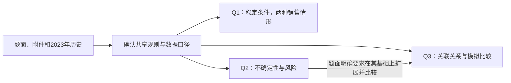

# 2024-C 全局题意与数据方案

当前状态：READY（仅基础数据已冻结，等待下一步授权）；冻结版本：G1-v1-base；日期：2026-09-06（Asia/Shanghai）。用户 U004 明确批准冻结候选 G1-v1 的基础范围，保留销量未知、不进入建模。原材料只读，没有构造正常销售量、模拟、优化或填写结果模板。24 项工具核验通过不等于逐条人工核验。以下保留题意、G1/G2过程及冻结记录。

## 授权与材料

用户在本任务首条执行请求中指定“开始练习 2024 年国赛 C 题”，材料为 `E:/Projects/SCUT-MathModel-2026/培训作业/第四次培训作业`，新项目为 `projects/2024-C`，明确“本轮只理解全题”“完成后停在题意确认点 G0”。后续“继续”只恢复该范围。检查时项目不存在，核实题号后通过 statectl init 初始化；没有覆盖已有项目。

材料只有一套，题面与所列附件相符：

| 来源 ID | 文件与位置 | 识别用途 |
|---|---|---|
| S0 | C题.pdf，第 1 页（全文一页） | 2024 年 C 题《农作物的种植策略》，背景、三问及附件清单 |
| S1 | 附件1.xlsx，乡村的现有耕地 A1:D55；乡村种植的农作物 A1:E46 | 地块、作物类别、适种地块与季次、规则及跨年季节说明 |
| S2 | 附件2.xlsx，2023年的农作物种植情况；2023年统计的相关数据 | 历史种植及面积；亩产量、成本、价格。统计表 B110:B111 有数据来源和智慧大棚第一季说明 |
| T11 | 附件3/result1_1.xlsx | 问题 1 滞销浪费情形 |
| T12 | 附件3/result1_2.xlsx | 问题 1 超额半价销售情形 |
| T2 | 附件3/result2.xlsx | 问题 2 不确定性方案 |

三个模板均含 2024—2030 七张年度工作表。各模板 B85:B87 注释：填每季各作物种植亩数，单季作物填第一季，保持模板形式。G0 时仅核对 2024 页，G1 已检查全部 21 张年度表的表头、地块标签和说明，年际一致，C2:AQ83 结果区域均为空。题面没有指定问题 3 的独立 Excel 模板。本轮不创建或填写任何结果工作簿。

附件只读检查用于识别含义及 G1 质量审计；获 U003 批准后仅在独立候选目录生成结构化数据。openpyxl 读取出现页眉页脚解析警告，未保存工作簿；因此不能称已核验完整 Excel 显示格式。PDF 已提取全文并渲染目视核对，渲染有字体提示但关键文字及数值可读。

## 全题共同任务

给村庄安排 2024—2030 七年的种植计划：每年、每季、每块地、每种作物安排多少亩。仅回答“种哪种最赚钱”不够，需满足地块适种性、季节、面积、轮作与管理要求，还要考虑卖不完的后果。

S0 给定露天耕地 1201 亩、34 块，普通大棚 16 个、智慧大棚 4 个，每棚 0.6 亩。G1 审计及 G2 工具核验已与附件数量和面积求和核对一致。

S0 与 S1 共同规定：

- 平旱地、梯田、山坡地每年一季粮食类作物（水稻除外）。
- 水浇地可选择一季水稻或两季蔬菜；种两季蔬菜时，第一季排除大白菜、白萝卜、红萝卜，第二季只能在这三种中选一种。
- 普通大棚第一季种蔬菜（排除上述三种），第二季种食用菌；食用菌只能在普通大棚秋冬季种。
- 智慧大棚两季蔬菜，也排除上述三种。
- 一般允许同一地块同一季合种多种作物，但水浇地第二季的专门规则限制为一种。
- 不能连续重茬；从 2023 年开始，每个地块的所有土地三年内至少种一次豆类；种植不能太分散、单块地上的种植面积不宜太小。

例如，今年只追求高收入可能占用明年必须轮换的地，也可能让三年豆类要求无法满足。所以七年需要联动考虑；2023 年历史种植是 2024 年的边界条件，不是可重新安排的决策。

## 逐问解释与交付

### Q1：条件稳定时，如何安排七年种植

事实：预期销售量、成本、亩产量、价格相对 2023 年稳定；当季生产、当季销售；超出当季预期销售量的部分不能正常销售。分别处理完全滞销和按 2023 年价格 50% 出售。

教学例子（虚构，不是附件统计）：某季产 120 斤，正常能卖 100 斤，正常价 2 元/斤。滞销时收入为 200 元；半价时剩下 20 斤每斤卖 1 元，收入共 220 元。两者均须扣除全部种植成本，滞销不等于种植没有成本。

交付：两套完整七年面积方案，分别进入 T11、T12；解释收益及农业约束为何满足。建议以七年累计种植净收益为主要目标，但“最优”的正式数学目标仍待批准，不能只最大化产量或收入。

依赖：S1、S2、共同口径；未来研究中先形成经过核验的基础约束和收入计算，供后两问沿用。不能把“稳定”误解为七年重复同一张表，因为轮作跨年约束仍在。

### Q2：未来会变化时，如何兼顾收益和风险

事实：小麦、玉米销量平均年增长 5%—10%；其他作物每年销量相对 2023 年约 ±5%；亩产量每年约 ±10% 波动；成本平均年增约 5%；粮食价格基本稳定；蔬菜价格平均年增约 5%；食用菌年降约 1%—5%，羊肚菌年降 5%。区间及“平均”“左右”不直接给出概率分布。

困难：一个方案在正常年份赚得多，遇到减产或价格下跌可能亏得多。仅把所有变化取中间值，不能说明已考虑风险。

教学例子（虚构）：方案甲多数年份收益较高，但差年份严重亏损；方案乙平均收益略低，却在坏年份更稳定。选择取决于愿意牺牲多少平均收益来降低坏结果的风险。此处只解释概念，不选择算法或风险权重。

交付：T2 中的完整七年面积方案，以及收益、坏情形表现、可行性和不确定性假设的解释。具体衡量指标及验收协议在本问授权阶段提出。

依赖：共同数据与约束，推荐复用 Q1 已验证的规则及收益计算。Q1 是工程与研究顺序上的推荐上游，题面并未要求把 Q1 的种植面积固定给 Q2。

### Q3：作物和市场相互影响时，方案会怎样变化

事实：题面要求在 Q2 基础上考虑作物替代/互补及销量、价格、成本的相关性，用模拟数据求解，并与 Q2 比较。

教学例子（仅作概念解释）：替代性是某种菜涨价后顾客转买另一种菜；互补性是某种消费增加会带动另一种消费。两种蔬菜销量同时上升可能只是共同季节因素，不能单凭同涨同跌就断言互补。哪些作物成对、关系方向和强弱，题面并未提供确定答案。

交付：七年种植策略、模拟数据的生成假设及可复现依据、与 Q2 的比较。推荐让 Q2、Q3 方案在相同的一组未来测试情形中接受评价，以识别关系假设的实际影响；不能各用有利情形证明自己更优。无改进、收益与风险各有得失也须保留。

依赖：Q2 的风险口径、基础方案和评价方式；共享 Q1 的农业约束。题面没有指定 Q3 结果文件名，建议将策略、模拟和比较放在后续 Q3 研究成果中，具体格式届时确认。

## 依赖与核心问（G0-v2 更正，U002 确认推进）

先准备 Q1；Q1、Q2 都列为 CORE。Q1 需要准确表达七年农业约束并验证可行性与求解质量；Q2 另需验证风险决策。CORE 不限一个，也不要求复杂化。Q3 仍需认真检验关系假设。按 Q1→Q2→Q3 做是研究顺序，后续小问仍需分别授权进入。

更正：Q1 与 Q2 共享基础但独立求解，不将工程复用变成 Q2 必须依赖 Q1 冻结结果的硬条件。正式状态已按对话上下文及 U002 更新 Q1/Q2=CORE，Q2.depends_on=[]，Q3 仅依赖 Q2（尚未绑定冻结版本）。三问均 NOT_STARTED，active_question=null。G0-v1 的错误拟议依赖保留在历史中供追溯，不再有效。

## 待确认口径与风险

| ID | 不明确之处 | 影响与建议（全部待确认） |
|---|---|---|
| G0-01 | “最优”没有精确目标，管理方便没有量化标准 | 建议 Q1 看七年累计净收益；Q2、Q3 同时评价平均收益及坏情形损失。最低种植面积、分散上限不凭空填数，在数据方案/本问计划中提出具体值与依据 |
| G0-02 | 预期销售量的 2023 基准 | 已读统计表表头没有单列销量字段。不能把种植面积或生产量当作已证实销量；后续审计可检查是否存在其他依据，必要时提出“2023 年按季产量近似销量”假设，但未获批前不计算、不采用 |
| G0-03 | 2023 销售单价是区间，如 H2 为 2.50—4.00 元/斤 | U003 已批准保留区间并增加中点候选，现已执行；中点仍不是实际成交价，尚未作为最终模型价格冻结 |
| G0-04 | 连续重茬如何处理单双季、跨年及地块内合种 | 建议按实际种植序列讨论同地块相邻茬次并纳入 2023 边界；整块禁止同作物连续出现，还是按地块内实际占地判定，需要确认。不能只比较同年两季而漏跨年，也不能因单季有空季就默认可连续种同作物 |
| G0-05 | 三年豆类要求及合种覆盖 | 建议按滚动三年窗理解，首窗 2023—2025，计划内末窗 2028—2030，须覆盖所有土地；不能用一小块豆类代替全地块合规。仅三年豆类面积加总不少于地块面积也未必证明覆盖，因为可能反复种同一位置；后续表达需可实现或核验空间轮换，不将窗口外未来决定伪造成已安排 |
| G0-06 | Q2/Q3 超额作物如何处理 | Q2 未明确继承 Q1 哪种销售情形。建议将半价出售作为待选主口径，同时保留滞销情形作敏感性比较；折价是相对当年正常价还是固定 2023 价也需明确。均未采用 |
| G0-07 | 随机变化基准、累积方式、分布与关联 | 其他作物销量明确相对 2023 年 ±5%，不应自动变成逐年复利随机游走。小麦玉米的趋势、年度亩产波动的参照及成本价格变化的随机幅度需分别声明。区间不自动等于均匀分布，Q2 也未规定变量独立 |
| G0-08 | 季次对应的时间与销量汇总 | S1 注释给出的普通棚第二季、智慧棚第二季会跨年，不同设施“第一季”日历也不完全相同。后续需明确按模板种植年度归属，并核对当季销售与销量合并规则，不能默认全年销量跨季挪用 |
| G0-09 | Q3 关系参数与七年策略的信息边界 | 缺少直接的关系参数与多年序列；只能把模拟设定标成假设，不能说由附件证明。七年一次定案还是逐年根据已观测信息调整也需说明，不能在决策时使用当时尚不知道的未来随机值 |

上述语义问题并未因用户要求继续而自动确定。U002 允许先做 Q1 前置的只读调查和数据方案；本轮定位得到的数据证据见下文。未定项仍阻止相应正式口径落地或建模。

## G0 历史确认范围与许可边界

用户先指出 Q1、Q2 独立且都重要，助手已在聊天更正依赖并建议双 CORE；随后用户明确“那先弄问题一，继续下一步吧”，并再次“继续”。U002 依据该上下文允许推进必要的只读审计和方案，最多到 G1。未将其解释为批准旧 G0-v1 的单 CORE/错误依赖，也未将其解释为对所有未定语义的默示同意。清洗、补值、价格取值、销量构造等执行均另需 G1 具体授权。

2026-09-07更新：用户已明确冻结Q1-D-v2-candidate，并授权进入Q2候选准备到A。Q1冻结快照有效；Q2-A-v1只形成候选与试跑协议，尚未运行。

## 来源版本与核验边界

以下 SHA256 在本轮读取后记录，用于未来识别材料版本，不是处理后数据冻结，也不是人工核验：

| 文件（相对材料目录） | SHA256 |
|---|---|
| C题.pdf | c7b5e58bff4189b8afba5505f7bff7d4f08280fc291c51ef3f46134ebbf74f9a |
| 附件1.xlsx | b799a137294a5c5497fed9667c5dfed6c967f1fb180316c5adc8509cfa6f0932 |
| 附件2.xlsx | 869081a3ab47d3bf8d0955106b622aaf0fd2c068fada7948da69b20ebf1d00ce |
| 附件3/result1_1.xlsx | 4f2484c0d70a5c4d047163f2ee6ef486949e813330466f46def4bd7d98af06af |
| 附件3/result1_2.xlsx | 6166d43f5a64bf9d1657e80d4aee7f10f54bb1a5695b81a28a0ac5e657297649 |
| 附件3/result2.xlsx | 6a1ba9fc28d14d0a4a795e5f0b7261fb6e32165517afee62bcd1931aba5bee8a |

数据和结果的实际人工核验均待进行；用户关于研究方向的决定不等于人工核验数据。当前只新增结构/质量审计结果，没有优化收益或模型优劣结论。本次为历史赛题练习，不开展当届提交规范核验或外部解法搜索。

## G1-v1 只读审计结果

证据：`audit/G1-v1/audit.json`；可复现脚本 `scripts/audit_g1.py`。Python/openpyxl 3.1.5 只读取原工作簿，并用原始 OOXML 数值独立复核数量和面积。未导出清洗表或需求参数。六个材料文件读取前后 SHA256 一致，且与 G0 记录一致。

### 文件粒度、关联与数量

| 表 | 一行代表什么 | 关键识别字段 | 实际数据记录数 |
|---|---|---|---|
| 乡村的现有耕地 | 一个地块或大棚 | 地块名称 | 54 |
| 乡村种植的农作物 | 一种作物 | 作物编号 | 41 |
| 2023年的农作物种植情况 | 某地块、某季的一种作物面积 | 地块＋作物编号＋季次 | 87 |
| 2023年统计的相关数据 | 某作物在一种地块类型和季次下的参数 | 作物编号＋地块类型＋季次 | 107 |

诊断使用合并单元格锚点和标签首尾空白比较，未写回原表或生产表。四类键在该读取口径下均无重复；历史记录无未知地块或作物，名称/类型对应无冲突；核心表未发现公式单元格、Excel 错误值、批注或隐藏行列。未发现的是本轮覆盖的错误类型，不保证现实数据全部正确。

| 地块类型 | 数量 | 面积合计/亩 | 单块面积范围/亩 |
|---|---:|---:|---:|
| 平旱地 | 6 | 365 | 35—80 |
| 梯田 | 14 | 619 | 20—86 |
| 山坡地 | 6 | 108 | 13—27 |
| 水浇地 | 8 | 109 | 6—22 |
| 普通大棚 | 16 | 9.6 | 0.6 |
| 智慧大棚 | 4 | 2.4 | 0.6 |

露天地块共 34 块、1201 亩，与题面一致；加大棚后物理面积 1213 亩。2023 年种植面积按季相加是 1292 亩次（单季 1134、第一季 79、第二季 79）。1292 大于 1213 来自重复使用土地种两季，不是占地超限；逐个已记录的地块—季次合计都等于地块面积。

41 种作物分为粮食豆类 5、其他粮食 11、蔬菜豆类 3、其他蔬菜 18、食用菌 4。历史种植有 7 个地块—季次合种，单条面积最小 0.3 亩、最大 86 亩。因此“所有地块最低种植 1 亩”会直接排除 0.6 亩大棚，不应采用；0.3 亩也只是历史观察，不自动成为未来硬阈值。

### 三类容易被错误处理的内容

1. **合并单元格不是缺失地块。** 历史地块列 33 个空单元格位于实际合并区域内。例如 A28:A29 的锚点 D1 同时适用于两季。E15 的 A70:A72 覆盖第一季生菜 0.3 亩、油麦菜 0.3 亩和第二季羊肚菌 0.6 亩；第一季两行是合法合种，不可当重复删掉。仅在显式合并范围继承锚点，不全列任意向下填充。
2. **参数省略有明文依据。** 87 条历史记录中 81 条直接匹配参数，6 条智慧大棚第一季记录按统计表 B111 对应普通大棚第一季。按附件 1 明文适种规则枚举，合法作物—地块类型—季次共有 125 个：107 个直接参数、18 个可由 B111 明确引用，未发现其他无法匹配项。18 个引用项不是新增观测，也不等于对任何缺失值做均值填补。
3. **价格有季节区别。** 107 条价格均为可解析且上下界有序的正区间。18 种作物有不止一个价格区间，但本次未发现同一作物同一季次跨地块类型的价格区间冲突；差别对应季次。例如不能把同一种菜不同季的价格混成一个全年均价。参数识别必须保留地块类型和季次。

土地面积、种植面积、亩产量与成本未发现非正值。亩产从 100 到 15000 斤/亩，成本从 350 到 10000 元/亩，跨度本身不证明异常：统计表 F42 为山坡地荞麦 100 斤/亩，F78 为普通大棚黄瓜 15000 斤/亩，G89:G90 为白灵菇/羊肚菌成本 10000 元/亩。建议保留，不做全作物统一异常删除或标准化。

### 销量信息不足：不把“没种”说成“没人买”

全部输入表均未提供独立的实际销售量或需求观测表。87 条历史种植记录覆盖 47 个作物—季次组合；按明文适种规则有 59 个可用组合，因此 12 个合法组合没有 2023 种植记录：

- 第一季：菠菜、芹菜。
- 第二季：豇豆、刀豆、芸豆、土豆、菜花、包菜、油麦菜、辣椒、空心菜、黄心菜。

后续可以用“种植面积 × 对应亩产量”估算历史产量；它仍不是直接记录的实际销量。若进一步把它设成正常销售上限，是需声明的市场假设。对于上述 12 项，没种意味着没有该季本村生产记录，不证明市场需求为零。不能自动补零，也不能把年度数量任意复制给两季而重复计算市场容量。

待选方向：

- 历史按季产量代理：简单可追溯，但把未种组合设为零会限制换季种植，是强假设。
- 作物年度代理量再按季分配：允许换季，但分配比例无直接证据，不能均分后宣称题面给定。
- 在后续 Q1 候选计划中比较明确的需求情景：不隐瞒不识别性，但需预先约定范围和敏感性检查，尚未授权执行。

本轮推荐先生成可核验的历史产量依据并保留上述未观测标记，不在数据清洗里选定市场模型；需求假设须在冻结包含需求参数的数据版本或正式试跑之前明确批准。Q2/Q3 的销售规则、概率与关系参数本轮不研究。

### 时间、单位和模板边界

- 保留亩、斤、元/亩、元/斤，不转成公斤而漏乘除 2。面积乘亩产才是斤，面积乘亩成本才是元；价格不直接乘面积。
- 原始“单季”标签保留；将来填表映射至第一季，不代表把原始单季标签全替换为第一季。
- 大棚第二季可能跨年；候选表保留种植年度及源季次，不自动改为收获年度。不同设施的同名季次是否共享一个销售池，仍是需求口径待定项。
- 2023 年是历史，不是 2024—2030 决策年份；无多年销售序列，不能把同一年的不同作物/地块当成多个时间样本拟合趋势。
- 三个模板共 21 页 C2:AQ83 结果区域均为空，空格是待填位置，不是零值观测。Q1 只计划将来生成自己的两个结果副本；当前不写任何结果工作簿。
- 本轮无需画全作物极值图：跨作物量纲虽同但生物类别差异大，统一箱线阈值会诱导误删。数量/范围表、具体单元格证据更直接支持保留原值的决定。

## G1-v1 候选数据处理批次（U003 已批准，P01—P07 已完成）

用途：为 Q1 准备可追溯、可核验的基础表，把文件结构问题与市场假设分开记录。本批次仅数据准备，完成后停 G2，不能因此启动 Q1 模型。

输入：上方六个原始文件的已记录哈希；G0-v2 明文规则及本审计。不修改原文件，不使用外部数据。

| ID | 获批操作 | 依据、可逆性与执行边界 |
|---|---|---|
| P01 | 在项目候选目录生成地块、作物、历史种植、原参数四类 UTF-8 表及来源索引 | 每条记录保留源文件、工作表、行/单元格、原值。原始数据不搬移覆盖；输出明确标 candidate |
| P02 | 只在标识/分类字段去除首尾空白；按明确合并区域读取锚点 | 例如普通大棚末尾空格、菠菜名称空格。保留 raw_value 与原合并范围；不改内部字符、不模糊匹配、不对其他空值盲目填充，不删合种行 |
| P03 | 根据附件规则生成合法适种键；增加 18 条智慧棚第一季的来源引用参数 | 保留 107 条原参数；新增项标 derived_from_note，指向普通棚对应行与 B111。不跨其他地块/季次补值 |
| P04 | 销售价区间拆成 lower/upper，另生成 midpoint 候选列 | 中点只作为拟议 Q1 基准价，不是观察到的成交价；两个端点保留。按作物/地块类型/季次保留差别，不取全年均价 |
| P05 | 按 2023 年种植面积与匹配亩产计算历史产量估计及 47 个已观测作物—季次汇总 | 只命名为 production_estimate，不命名为 observed_sales；未观测 12 项在覆盖表中标 unobserved，需求字段留空，不补 0；不设正式正常销售上限，不推算 2024—2030 |
| P06 | 保存 2023 历史和模板映射 | 单季保留原标签，单独记录填到第一季的映射；保留豆类类别、合种面积，但不猜地块内空间分区或宣布轮作满足；只存模板坐标映射，不写模板 |
| P07 | 独立核验、候选版本清单和变换日志 | 原始/候选前后数量、单位、面积、覆盖和来源核对；停 G2，由用户核验。未知销量、空间覆盖等保留为未决，不据此声称可以冻结全部模型输入 |

实际输出目录：`data/candidates/G1-v1/`，包含 lands.csv、crops.csv、planting_2023.csv、parameters_original.csv、parameters_effective.csv、production_2023.csv、coverage.csv、template_mapping.json、manifest.json、transform_log.jsonl、validation.json。来源和有效参数分开防止把引用误当原观测。

预算：一次候选数据批次、一次独立核验；如失败仅修复实现错误并复核受影响检查。不联网、不运行模拟/优化、不新增销量假设或管理阈值。新语义冲突立即停并报告。

验收：54 地块、41 作物、87 历史记录、107 原参数保持；125 有效参数键均有明文来源；33 个地块合并子单元格都能追溯锚点；54 地块物理面积 1213 亩，2023 季面积 1292 亩次，地块—季次不超面积；单位正确、键不重复、价格上下界与原字符串一致、中点另列；47 个观测组合产量有源行链，12 个未观测组合不填需求零；原始哈希不变。产量派生需另外抽样手算，不用同一段聚合代码给自己作证明。

停止点：G2 候选数据核验。G2 前后仍须解决 Q1 销量代理及未观测季次的处理，才可冻结相应需求参数并正式建模。可先核验事实基础表，但不得把未知需求或未明空间规则说成已批准。

U003 用户实际原话：“批准 G1-v1，先准备 Q1 候选基础数据；价格保留区间并加中点候选列，销量缺口保持未知，完成核验后停 G2，不建模。”已依此完成批次，没有扩大范围。

## G2-v1 候选数据交付与核验

### 产物与实际变换

| 文件 | 行数/内容 | 本轮结果 |
|---|---|---|
| lands.csv | 54 个地块 | 保留面积，规范首尾空白，逐字段保存原单元格与原值 |
| crops.csv | 41 种作物 | 保留原编号、类别、适种文字及说明；豆类类别另标志，不推断空间种植位置 |
| planting_2023.csv | 87 条历史记录 | 33 个地块合并子单元格按实际锚点读取；保留所有合种记录、2023 年和源季次；附行级参数引用与产量估计 |
| parameters_original.csv | 107 条来源参数 | 原价格字符串、上下界、中点候选分列；亩产与成本数值不改变 |
| parameters_effective.csv | 125 个有效参数键 | 107 个来源键＋18 个 derived_from_note 引用键；保留对应普通棚原行和 B111 说明 |
| production_2023.csv | 47 个已观测作物—季次组合 | 历史种植面积乘统计亩产后汇总；每项保留全部贡献行和参数 ID |
| coverage.csv | 59 个合法作物—季次组合 | 47 个有历史产量估计；12 个未观测的产量字段为空；全部 59 个 normal_sales_limit_jin 字段保持空白、demand_status=unknown_not_imputed |
| template_mapping.json | Q1 两个模板、共 14 年度页的映射 | 41 作物列与 82 地块—模板季次行标签已核对；不填写或另存结果模板 |
| transform_log.jsonl | 402 条逐项变换事件 | 记录锚点继承、首尾去空白、区间拆分/中点、明文参数引用、行级产量估计 |
| manifest.json / validation.json | 来源、代码与候选文件版本；核验结果 | manifest 哈希覆盖数据和变换日志；validation 引用 manifest 哈希及独立核验代码哈希，避免自引用哈希 |

全部候选 CSV 以 UTF-8 BOM 保存，便于读取中文；字段中的 source_cells_json 保留原始空格、空值、锚点值和合并区域。原材料没有移动、覆盖或另存。

### 独立核验与可手算例子

生成脚本 `scripts/build_candidate_g1.py` 使用 openpyxl；核验脚本 `scripts/verify_candidate_g1.py` 不导入生成器，也不使用 openpyxl，而是直接解析原 xlsx 压缩包里的 XML 和共享字符串，以 Decimal 数值重新比对来源、参数与产量。核验包含所有 87 条产量及 47 组汇总，不仅抽样。

24 项检查全部通过。核心内容：原值/锚点/合并来源一致；54/41/87/107 记录没有丢失、重复；125 参数键与明文适种规则一致；18 引用有来源；价格上下界与中点精确；历史面积守恒；行级产量和汇总独立复算一致；59 个需求为空、12 个未观测产量不补零；14 页模板映射一致；六份源文件哈希仍与 G0/G1 一致。

以下例子供用户核对，不代表用户已经实际核验：

| 例子 | 面积来源：附件2/2023年的农作物种植情况 | 亩产来源：附件2/2023年统计的相关数据 | 计算 |
|---|---|---|---|
| D1 第一季土豆 | E28：15 亩 | F51：2000 斤/亩 | 15 × 2000 = 30000 斤 |
| E15 第一季生菜 | E70：0.3 亩 | F79：5000 斤/亩 | 0.3 × 5000 = 1500 斤 |
| F1 第一季空心菜 | E75：0.3 亩 | F81：普通棚 12000 斤/亩，经 B111 引用 | 0.3 × 12000 = 3600 斤 |

所有历史记录的产量估计合计 1260505 斤。这是跨作物、跨季的复算校验量，不能作为销量、市场容量或利润；也不表示已核验真实收成。原数值范围和历史面积分布保留，没有删极值、截尾或标准化。

### 当前决定和边界

G2 交付当时：候选版本 G1-v1 尚未冻结，data_version=null，三问 NOT_STARTED。U003 仅为处理授权。随后 U004 的明确冻结决定见下节，不回写或伪造当时的核验状态。

建议在 G2 先核对本版基础数据及上述例子。若确认冻结基础数据，范围只能包含来源、价格候选、历史产量估计及明确未知标记，不得把该决定解释为销量参数、空间轮作或最终模型已确定。销量代理和 12 个未观测组合仍需单独讲解并批准，才能形成完整的 Q1 求解输入。

可以回复“保持 G2，先讲清销量口径如何选择”，在当前关口继续解释；也可以指出需要复核的记录。若用户希望先冻结本次基础范围，须明确指定“冻结候选 G1-v1 的基础数据范围，保留销量未知，不进入建模”，届时再记录真实授权和版本，不自动执行。

## 基础数据冻结 / U004 / G1-v1-base

用户真实决定：“冻结候选 G1-v1 的基础数据范围，保留销量未知，不进入建模。”

已将通过 G2 工具核验的11份候选文件逐字节复制到 `data/frozen/G1-v1-base/`，另归档生成与独立核验代码，以及 freeze_record.json 的范围/授权说明。原候选和原材料保留；冻结副本与 G2 所记录的哈希一致。state.json 的 data_snapshots 记录全部14份冻结文件 SHA256，并经单独完整性检查。现有 statectl 负责状态转换校验；它不自动校验扩展的 data_snapshots，故本轮显式逐文件核对，不夸大其能力。

冻结范围包含价格中点候选及历史产量估计，但不将其升级为实际成交价、销量或正式模型参数。59个正常销售上限仍全部未知，12个无历史种植组合仍未补零。基础版本以后可稳定引用，新增需求假设必须另行授权、记录新版本或协议，不覆盖本冻结目录。

正式状态 READY / WAITING，data_version=G1-v1-base，active_question=null，三问仍 NOT_STARTED。READY 在此只说明本次批准的基础范围已固定，不代表 Q1 已具备完整需求参数或获准建模。用户已批准冻结；未提供逐条人工核验过程，不登记虚构的人工核验。
