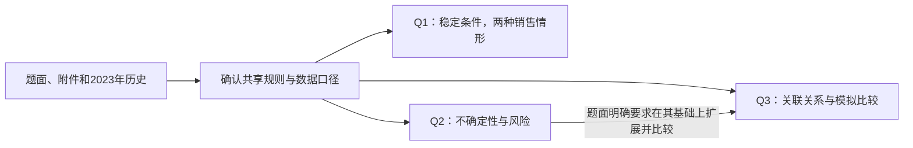

# 2024-C 全局题意与数据方案

## 2026-09-10 数据预处理、EDA与局部论文交付：DATA-EDA-PAPER-v1

本轮用户明确要求按Skills完成预处理、EDA、必要图像及对应论文；U032/U033登记执行与局部写作许可。E1—E5已完成。基础预处理采用已确认G1-v1-base及原值/锚点/明文引用，未发现新的数值修正依据，因此新增数值改动0、数据行改动0；描述性汇总不是新冻结模型输入。本文所称完成限定为现有资料可支持的本批数据工作，不代表已识别销量、未来概率或因果关系，不进入Q1。

### 真实探索发现及含义

| ID | 本轮结果 | 分析方法与依据 | 对认识/建模的含义 |
|---|---|---|---|
| EDA-01 | 总物理面积1213亩；梯田619亩/51.03%；20个大棚占54地块的37.04%，面积仅12亩/0.99%；露天地块6—86亩，大棚均0.6亩 | lands源字段按地类计数、求和与中位数；FIG-EDA-01 | 数量和容量不等价，管理尺度需依地块大小；不构造交通距离或统一最小面积阈值 |
| EDA-02 | 原规则125个作物—地类—季次组合中64个历史有记录、61个无记录；按作物—模板季次则59合法/47观察/12未观察 | 原适种规则与历史键覆盖；FIG-EDA-02；两种粒度分开 | 不用历史选择替代可行适种集合，不把缺记录设为需求零；并未证明农业轮作可行 |
| EDA-03 | 历史1292亩次=露天地1268+大棚24；水浇地42亩单季稻+67亩两季蔬菜=176亩次；80地块季次组中7组合种2种作物 | 历史原面积按地类/类别累计，地块季次计数；FIG-EDA-03 | 解释复种与面积守恒；历史满种不强加为未来义务，合种不去重 |
| EDA-04 | 豆类400.8亩次、19去重地块；小麦222亩次/4地块，羊肚菌4.2亩次/7大棚 | 原类别含豆类、历史面积汇总及land_id去重；FIG-EDA-05明细 | 面积和地点数反映不同尺度；不把累计亩次当实际空间覆盖、不证明三年豆类约束 |
| EDA-05 | 原107参数分粮食46、蔬菜57、食用菌4；对应成本范围350—2000、500—5500、2000—10000元/亩 | FIG-EDA-04分面同尺度对数散点；同坐标合并仅显示，源行全留 | 分类别理解数值尺度，不机械删跨类极值；不用参数行做独立样本推断 |
| EDA-06 | 15种非水稻粮食均平旱地亩产>梯田>山坡地，同作物三地类成本/价格区间相同；小麦800/760/720斤，成本450元，价3—4元/斤 | paired_grain.csv逐作物配对，原参数源行独立复核 | 需要保留地类参数维度；不作地类因果效应或新规则推广 |
| EDA-07 | 原107条价格记录按作物及相同区间合并显示为59组，其中18蔬菜具有智慧棚第二季单独区间 | FIG-EDA-06原端点，无中点，sources保留全部107行定位 | 保留季次差异，价格区间非置信区间/概率；不能只按价格或亩产排最佳作物 |
| EDA-08 | 种植季历与模板位置继续按已核资料，销量独立字段仍缺 | 论文表3；AUD-R06及META-R04 | 时间表不制造销售池、跨年收益规则或多年联合观测；11项未决语义继续有效 |

研究输入与全部派生汇总在data/eda/DATA-EDA-PAPER-v1/results/eda.json及4张CSV，仅描述性分析输出。analyze.py不导入旧研究脚本、不读取既有产量/中点为计算输入、不求解或模拟；plot.py只消费锁定EDA JSON。源摘要107行和适种125组合的职责分别记录；18条引用不重复进入参数分布。

### 预处理与图表取舍

复用已获确认的标签规范化、合并锚点、参数引用、价格区间、模板对应及未知标记；行/数值变换0，不重新生成一份相同清洗表。新汇总的公式/单位为按组求和原面积（跨季亩次）、按ID去重地块数、同类面积除总物理面积、按原规则与观察集合比较；对数变换仅坐标显示，不写回数据。缺失结构、重复键、异常候选、单位和关联已有AUD-R01—08真实审计与本轮源字段复核支撑。

正文四图：地块尺度、历史种植结构、适种/观察覆盖、亩产成本分布；附录两图：41作物历史规模明细、全部原价格区间。详见唯一figure_registry的FIG-EDA-01—06。资料结构/处理身份/季历三张表承担精确条件，无额外装饰图或重复饼图。没有多年观测/销量/地块坐标，所以不作时间趋势估计、需求相关热图或地理分散图；没有经营销量与处置口径，因此不作实现收益排名；暂不做依赖模型与目标的标准化、特征选择、训练测试切分或敏感性实验。这些是不适用/缺少信息的具体判断，不以凑齐分析模板替代研究。

### 核验、写作与交付

- 数值：verify.py从原附件ZIP/XML读取、Decimal独立核对6类土地、41作物历史组、30类地块种植单元、410适种矩阵格及107×4亩产/成本/端点值，豆类与合种数量一致，verification.json无失败。采用原规则另行编码，对照分析所用映射；同一AI的另一解析路径，不称人工复算。
- 复现：分析结果results与results_reproduction的EDA JSON相同；最终六图figures_final与reproduction_final的PNG/PDF字节一致，technical_checks.json记录。SVG可编辑，但没有宣称其随机ID/时间元数据字节一致。
- 保护：此前423项原附件/冻结/旧论文及图保护文件哈希保持，statectl验证旧冻结有效。本轮论文源、图、派生统计为新路径，不覆盖前置稿或全文。
- 论文：paper/data_eda_v1/chapter.md、chapter.tex、chapter.pdf，4页正文+2页附录，3表+4正文图+2附图；来源为本次EDA统计（EDA-01—08）及AUD/META证据，非旧模型结果。当前为主执行者起草、AI核对、待用户审阅；数据章请求不等于全文整合授权。
- 段落自检：第一节只交来源与实际处理；第二节新增土地尺度与历史结构；第三节新增适种/观测分离；第四节新增同作物参数差异、价格/季历使用关系。未复制题目重述或宣布模型。共同“未知不是零”集中于来源/覆盖，各处只保留影响本主张的界限；附录承载41种明细，正文不逐项复述。价格不作排名，亩次不改写为空间覆盖。
- 排版：LaTeX生成6页，全部渲染页已查看；修正图3黑点字形、附图对数刻度缺字、图内字偏小及正文误归为题注，最终无Overfull/缺字/未定义引用；PDF提取文字均黑色，未越出页面。图在实际页宽下可读；没有真人计时试读或全篇比赛提交规范验收。本轮数据章属于2024题训练局部草稿。
- 环境：描述计算bundled Python3.12.14/NumPy；bundled缺matplotlib，制图采用现有Anaconda Python3.13/matplotlib3.11.1，字体SimSun；LaTeX/Poppler排版。Anaconda DLL与MiKTeX缓存访问初次被沙箱阻止，限定命令获自动审批后成功，无自动审批拒绝遗留。

完成后停WAIT_G2，计划DATA-EDA-PAPER-G2-v1仅确认本轮描述性EDA与章节交付，仍保留G1-v1-base；不请求替代旧研究冻结，不自动进入Q1或恢复全文。具体未决语义仍为V2-U01—U11，后续若选定并改变数据/模型口径，另行列影响与授权。

## 2026-09-10 数据探索与章节执行计划：DATA-EDA-PAPER-v1

用户明确要求完成Skills范围的数据预处理、EDA、必要代码图及对应论文。本次据此授权执行数据回访与局部写作，不再重复申请已有授权；原G1/G2确认的基础字段及保留口径继续适用。预处理复用G1-v1-base（既有标签规范化、明文引用、来源映射），无新的数值清洗批次；既有派生产量与中点候选不作为本轮事实输入。销量、季历归属、农业空间覆盖及概率/关系的11项未决语义不选择，不重开旧模型，不运行优化。

具体分析：E1按地类统计数量、面积与地块尺度；E2原适种规则与2023观测的覆盖矩阵；E3按地类/作物类别汇总历史播种面积、合种及豆类记录，仅描述2023；E4按作物类别展示107条原统计参数的亩产/成本/价格差异，按同作物条件比较，不估计跨年相关/因果；E5整理月份、模板对应及信息缺口。汇总采用既有源字段，新JSON/CSV仅作分析结果，不替换模型输入。无销量代理、价格中点新选择、删点、插补、缩放或模拟。

先锁定输入与图的结构，再编程：正文拟用土地规模双图、适种/观测矩阵、历史种植结构、亩产与成本散点；明细用全部作物历史面积/地块数及原价格区间图。是否保留以实际新增信息为准；不凑相关热图、假时间序列、收益排行榜或无坐标地图。每图登记来源/代码/单位/读图结论/使用边界，独立目录复现并看实际图及嵌入页。

输出仍为report、data证据、figure_registry中的本轮条目；分析与代码图放data/eda/DATA-EDA-PAPER-v1，论文新章节放paper/data_eda_v1（LaTeX/PDF及可编辑文字），旧草稿/全文保持。本轮预算为完成上述有限描述性分析、必要调试、核对、代码图与局部章排版，不含新模型/实验，不沿用已结束的10分钟预算；完成即停本次G2交付，不冻结新数据版本或自动进入Q1。验收：保护哈希、独立原附件汇总对照、图复现、关键数字同源、全部渲染页检查、正文职责/边界自检。用户当前消息同时提供本批次执行与写作许可；不补造用户逐格核验或G2最终认可。

## 2026-09-10 本次数据回访已确认结束（G2-REVISIT-v1 / U031）

用户原话：“确认G2-REVISIT-v1：认可本次元数据与使用边界交接，保留G1-v1-base；不进入Q1、不恢复旧研究或论文任务。”本次交接已获确认，正式状态revision54/READY/WAITING，active_question为空，等待新任务。数据版本及已有冻结研究保持，不新建冻结数据集。下方待G2确认等文字为当时交付状态，以本条为最新。11项未决语义及证据限制继续保留；用户认可交接不记为逐格人工复算、旧假设重新批准或模型科学验证。仅登记确认，无数据、EDA、建模或论文执行。D033/AI031记录本次确认；此前metadata_handoff_check的哈希和revision53仅对应交付当时版本，本次确认文字追加不改写旧检查记录。

## 2026-09-10 G1-REVISIT-v1执行交接：仅元数据与使用边界（U030）

用户批准：“批准G1-REVISIT-v1：保留G1-v1-base，不新增数值处理；仅补充使用边界和元数据，预算10分钟，完成核对后停G2；不做EDA、不建模。”预算起点07:49:11 UTC。本节是本轮最新交接，下方G1待批等文字保留为历史。正式记录U030；本轮交付待确认版本G2-REVISIT-v1，数据版本仍为G1-v1-base，不建立新冻结数据集。

### 实际动作与字段使用范围

| 批准项 | 本轮落实 | 数值/数据行影响 |
|---|---|---|
| P01 标识与合并标签 | 复用既有land_id、crop_id及source_cells_json中的原值、锚点、合并区域；69处标签省略与83处边界空白沿用只读审计解释 | 0；未重新规范化或保存清洗副本 |
| P02 智慧棚引用 | 保留parameters_effective.csv中18个引用记录及B111来源身份；其来源是普通棚相应参数 | 0；未重新展开，也未新增观测 |
| P03 需求未知 | 保留coverage.csv的59项正常销量未知和12个合法但未观测种植组合的身份 | 0；不补零、不生成销量代理 |
| P04 价格与估计量 | 保留原价格区间；旧中点列是候选设定，旧产量列是估计量。当前批准仅保留其身份，不确认在新研究中采用 | 0；未重算中点、产量或收益 |
| P05 数值质量 | 根据AUD-R01—08，保留原值、合种记录和跨作物极端值 | 0；不删、不补、不去重、不缩放 |
| P06 元数据 | 在本报告和data证据中补充下表及语义边界，引用已有来源坐标和审计证据 | 仅说明文字；无数据表/模板/论文改动 |

### 单位、粒度与来源身份

| 对象/字段 | 单位与粒度 | 来源与使用边界 |
|---|---|---|
| lands.area_mu | 亩；每地块一条，表示物理土地容量 | 附件1“乡村的现有耕地”C2:C55；同一地块跨季不产生新土地 |
| planting_2023.area_mu | 亩；地块—作物—种植季次记录 | 附件2“2023年的农作物种植情况”E2:E88；跨季累计表达播种规模时用亩次，不能与物理面积直接等同；合种多行保留 |
| crop_id、land_id、land_type、season | 标识/类别，无物理单位 | 作物编号、地块名、地类与季次用于关联；类别编码不是数量；单季与第一季的模板对应不改变原季次 |
| yield_jin_per_mu | 斤/亩；作物—地类—季次参数 | 附件2统计F2:F108；B110说明为2023年根据近几年资料统计所得，不是逐年独立观测序列 |
| cost_yuan_per_mu | 元/亩；同一参数粒度 | 附件2统计G2:G108；本次不构造总成本或亩收益 |
| price_interval_raw及上下界 | 元/斤；同一参数粒度 | 附件2统计H2:H108；保留区间原文，中点候选不代表已观测平均成交价；区间经济含义尚未确定 |
| production_estimate_jin、旧production_2023 | 斤；历史面积与统计亩产形成的旧估计量 | 既有派生列/表，不属于原始销售观测；本轮只识别身份，未复算或重新认证数值 |
| normal_sales_limit_jin | 斤；既有coverage作物—模板季次键 | 59项保持未知；该键不证明真实市场需求按同名季次分池，未知不解释为零 |
| 附件3结果单元格 | 亩；年份—地块—模板季次—作物 | 2024—2030；单季填第一季。输出空位不是允许种植的判定，也不是零需求记录 |
| source_file/sheet/row、source_cells_json | 来源定位，无物理单位 | 源行、原值、锚点及合并区域保留。明文引用、原记录、派生估计分别使用，不能把展开行数当样本量 |

### 季历与年份边界

下表仅整理附件1“乡村种植的农作物”B44:B46的通常种植时段，没有新增销售日期或跨年计账规则。

| 地类 | 第一季通常时段 | 第二季通常时段 | 来源 |
|---|---|---|---|
| 水浇地（双季情形） | 每年3—6月前后 | 7—10月前后 | B44 |
| 普通大棚 | 每年5—9月前后 | 9月至下一年4月前后 | B45 |
| 智慧大棚 | 每年3—7月前后 | 8月至下一年2月前后 | B46 |

因此，统一模板标签只解决填表位置，不自动统一市场销售窗口。跨年第二季属于哪个收益年、是否与其他地类共享正常销量池，以及重茬的相邻茬口定义，继续保留为待决定语义。2023是历史种植记录的标签，2024—2030是方案模板年份；本次不把这些标签转换为新的时间序列，也不安排未来种植。

### 未决问题与历史影响保持

原V2-U01—U11全部保留，状态详见紧接下方审计节的逐项表：销量来源、价格代表值、重茬、豆类空间覆盖、管理量化、满种/闲置、Q2/Q3超额规则、增长与波动基准、销售季与跨年、决策信息、Q3关系依据。本次批准解决的是基础字段保留和说明范围，不选择上述模型语义。历史影响矩阵继续有效：销量/价格/季历影响收入，农业解释影响共同可行性，Q2评价与信息口径可能影响Q3比较。未改变输入或假设，不新增研究失效标记，也不宣称旧模型再次通过验证。

### G2-REVISIT-v1交接与验收

本轮核对元数据是否对应已登记源位置、单位是否与字段一致、P01—P06是否均有实际动作/保留说明，以及11项未决问题是否完整保留；文件完整性核对覆盖此前423项保护清单，并核对本轮入口的审计产物。结果与计时写入audit/AUDIT-REVISIT-v1/metadata_handoff_check.json，不重跑旧审计、处理或模型脚本。正式状态在完成后停WAIT_G2，等待用户确认本次回访交接。

可用于后续获批写作的材料为来源、结构、真实审计结论、无数值改动的理由及上述单位/来源边界。没有本轮EDA发现、数据图、模型结果或完整数据章；不为补齐模板而新增图表。当前没有论文修改授权。既有图和第一阶段草稿保持原版。

建议用户确认“G2-REVISIT-v1：确认本次元数据与使用边界交接，保留G1-v1-base；不进入Q1、不恢复旧研究或论文任务”。该确认只结束本次数据回访，不批准11项未决假设，也不记作逐格人工复算；确认后最多转READY等待下一项明确任务。当前尚未收到G2确认。

## 2026-09-10 数据回访只读审计完成：AUDIT-REVISIT-v1

**执行授权U029；审计版本AUDIT-REVISIT-v1；当前交付G1-REVISIT-v1，待用户确认，不执行处理。** 用户原话：“批准AUDIT-REVISIT-v1：只读审计，预算30分钟，完成处理建议和影响清单后停G1；不处理数据、不做EDA、不建模。”预算起点2026-09-10 07:29:49 UTC（15:29:49北京时间）。正式状态从revision49/WAIT_FINAL按脚本提交为revision50/DATA_PLAN，active_question清空，历史中保留原关口；data_version仍为G1-v1-base，三问冻结身份不变。

### 结论与已执行范围

R1—R7已按批准范围完成。原始地块、作物、种植记录和参数之间能够对应；本次检查未发现需要改写原始数值、删除记录或重新填补缺失值的证据。主要待决问题仍是正常销售量的来源、销售季与跨年归属、轮作空间解释及后续建模假设。审计结果支持保留既有基础字段与来源记录，不证明旧模型严格满足题意，也不批准继续使用所有历史假设。

脚本`audit/AUDIT-REVISIT-v1/audit_readonly.py`仅从原工作簿读取单元格/合并结构，进行诊断匹配、原面积加总、类型/端点检查及来源字段对照；`verify_diagnostics.py`独立用ZIP/XML核对关键面积、价格和模板结论。两者没有工作簿保存调用，没有导入旧研究模块或计算产量、收益、销量代理、价格中点；没有EDA、模拟、优化或填结果表。原有产量/中点列只作为既有成果的身份记录，不重算或用来形成研究结论。

诊断文件均在上述独立目录，属于审计证据，不是清洗后的数据集。`inventory.json`记录文件/表/范围/表头/合并区域，`diagnostic_details.json`记录坐标、匹配、面积与端点核对，`diagnostics.json`为汇总，`independent_checks.json`为独立路径结果，`protected_before.json`与`execution.json`记录完整性和实际执行。主报告仍是本节，不另外建立数据主报告。

### 数据结构和来源边界（R1）

| 原始材料与有效记录范围 | 记录粒度、主键候选与单位 | 本次核对 |
|---|---|---|
| 附件1“乡村的现有耕地”A2:C55 | 地块；地块名唯一；面积为亩 | 54个地块，包含大棚，键无重复 |
| 附件1“乡村种植的农作物”A2:D42，E2及B44:B46为规则 | 作物；编号唯一，适种文字可能是共享合并说明 | 41种作物，键无重复；保留规则与季历 |
| 附件2“2023年的农作物种植情况”A2:F88 | 地块—作物—季次的一条面积记录；面积亩 | 87条，合种是不同作物记录，不是重复样本 |
| 附件2“2023年统计的相关数据”A2:H108，B110:B111为附注 | 作物—地类—季次参数；亩产斤/亩、成本元/亩、价格元/斤 | 107条直接参数记录；B110说明为2023年根据近年资料形成的统计摘要 |
| 附件3三本原模板，2024—2030全部21页 | 年度—地块—季次—作物亩数，单季映射第一季 | 每页41作物列、82地块季次行（第一季54、第二季28），标签/年份与说明一致，待填区为空 |

三本模板的21个年度页分别核对，列名顺序对应41作物，第一季地块集合为54块，第二季集合为水浇地/普通棚/智慧棚28块，无未知或重复地块—季次标签；同本各年结构一致。模板空位只是输出位置，不代表该格允许种植或销量为零。原表单季填第一季的要求不意味着不同设施的第一季在同一月份销售。本次是结构/内容核查，未做21页视觉排版验收。

### 真实检查结果、来源与解释（R2—R6）

| ID | 检查发现 | 证据位置 | 判断与影响 |
|---|---|---|---|
| AR01 | 选定关键字段69处原始空白全部位于非空合并标签内：作物适种说明36处、种植地块33处 | 附件1作物D2:D16/D18:D35/D36:D38/D39:D42；附件2历史A列合并区域；blank_sources明细 | 是共享标签省略，不是69项未观测数值。范围不含说明区/空表输出；不宣称所有可能字段无缺失 |
| AR02 | 选定字段83格有边界空白字符：土地16、作物4、种植35、参数28 | whitespace明细逐格保留原文本，如土地B36 | 比较时仅在内存去边界空白，未写回。多行适种文字保留内部换行；旧规范化标识可复用 |
| AR03 | 地块键、作物键、地块—作物—季次历史键、作物—地类—季次参数键均未重复；名称/类别/适种匹配无失败 | history_key_checks、参数键诊断；原4表有效行 | 无去重依据；合种的多条记录不能删除成一条 |
| AR04 | 81条历史记录直接匹配参数，6条通过智慧棚第一季明文引用匹配；125个题意适种参数键中，直接表省略18个智慧棚第一季键 | 附件2统计B111及B66:H83；diagnostics | “省略”有具体来源，不能归为待统计插补。125为适配诊断键数，不是125次独立观测 |
| AR05 | 80个2023年地块—季次组原面积合计均等于容量，无超面积；独立XML结果一致 | area_capacity_checks，每组带全部历史源行；independent_checks | 对已记录种植组的质量核对，不证明未来必须满种、原始片区覆盖或多年轮作成立 |
| AR06 | 107个价格区间均可识别且端点为正、上界不低于下界；亩产、亩成本及历史面积检查无非正/非数值异常 | 附件2统计F2:H108、历史E2:E88；端点/类型诊断 | 本轮未计算价格中点；区间代表何种市场差异仍未提供说明，合法格式不证明代表价格已确定 |
| AR07 | 原始极端值有作物/地类背景：亩产最低荞麦山坡地100、最高普通棚黄瓜15000；亩成本最高白灵菇/羊肚菌10000 | 统计F42/F78、G89:G90；raw_extreme_review | 单位分别斤/亩、元/亩，属于跨作物原值极端候选；没有确认录入错误的外部依据，不截断或删除。未做分布、相关或收益排名 |
| AR08 | 原附件1/2没有独立预期销量字段；销售相关文字仅定位到统计H1销售单价、B111销售价格说明 | 全部源工作表XML单元格查阅；sales_related_source_cells；S0要求销量但未给数值 | 这是未提供的市场信息，不是通过清洗可恢复的空白；不得将历史产量当成已观测销量 |
| AR09 | 按模板季次标签诊断，59个合法作物—季次组合中47个有历史种植，12个无历史种植 | unobserved_legal_pairs，原适种规则与历史记录 | 未种植不等于需求零；这59个组合不是已确认的真实销售时段分组 |
| AR10 | 六份原材料与第一阶段v2来源哈希一致；旧基础4张表选定1704个来源字段与原单元格/合并锚点一致，18个明文引用参数的亩产/成本/原价格区间与普通棚源行一致 | independent_checks原6文件；frozen_source_comparisons，frozen_rule_parameter_checks | 可复用已核字段；未重算旧产量估计/价格中点、复核全部旧派生列或完整模型结果 |

12个无2023种植的合法组合：豇豆、刀豆、芸豆、土豆、菜花、包菜、油麦菜、辣椒、空心菜、黄心菜的第二季，以及菠菜、芹菜的第一季。完整名单与编号见诊断JSON。这类缺口无法用“把空白补成零”处理，否则会把没有种过误写成没有市场。

### 历史基础与后续成果的影响清单（R7）

| 事项与历史依据 | 本次核对支持/不支持什么 | 若未来改口径，影响哪些内容 |
|---|---|---|
| 合并锚点、边界空白、来源字段，旧freeze_record/transform_log及4张源字段表 | 1704个选定字段一致，支持保持这些基础字段；未发现重建基础表的必要证据 | 若只补来源/单位说明，不必重跑模型；实际字段变动则另行界定影响 |
| 销量代理，Q1/protocols/demand_scenarios_v1.json；旧coverage.csv | 旧59个正常销量字段仍为空；D0以及D05/D10的5%/10%分配是另层模型假设，曾获历史授权不改变其身份 | 会改变三问正常/超额销售分界和收入，需审查三问策略与论文相关主张 |
| 价格中点，旧parameters_original与Q1/report；Q2 uncertainty协议 | 原价格区间可读，中点是候选设定而非成交均价；本次不复算它 | 影响三问收益；Q3旧关系构造还用过价格/产量/成本特征，需检查相应关系输入 |
| 销售季/年份，附件1 B44:B46及Q1销量池键 | 水浇地约3—6/7—10月，普通棚5—9/9月至次年4月，智慧棚3—7/8月至次年2月；同编号季次不能自动证明同市场时段。旧按作物—年—季聚合是一项解释 | 销量池、跨期收益、历史接续与模板年份解释均可能受影响；只读审计不计算改动幅度 |
| 豆类与重茬，原题农业段、Q1/report共同约束、Q2-E018及已披露边界 | 原题要求所有土地；旧累计豆类面积不能单独证明实际空间全覆盖，已有披露不是本轮新发现；地块内历史片区位置未给 | 若改为可证明的空间覆盖语义，会影响共同可行性及三问；不是修改一个表格即可完成 |
| 管理与满种，原题定性要求、Q1/report经验阈值 | 原记录的满种和旧管理阈值不构成题面未来强制规则；没有地块坐标/片区位置字段支撑距离或空间覆盖实证 | 涉及三问可行域、管理评价和相关文字；后续单独明确，当前不重算阈值 |
| Q2/Q3销量、超额规则、信息与模拟，uncertainty/relationship协议及已批准corrections_v2 | 一次定案、Q2主销售解释、概率与关系系数为历史选择；旧协议的“拟议”状态属于保留版本，实际授权看正式state/decisions；本轮不把旧计划当现行实现证明 | 新假设可能改变Q2/Q3方案比较；Q3对Q2有明确依赖。历史已披露实现偏差保留，不在本次复跑或宣布消除 |

本轮没有确认新的原值冲突或新增版本失效，不清除历史限制，也不将已披露限制重复包装为新错误。保持G1-v1-base与三问FROZEN/VALID只表示本轮未改变原版本及其已有边界；不是重新通过了旧模型的科学验证。原18页论文、第一阶段4页草稿及各版图均不修改。

### 第一阶段11项歧义逐项回填

| 原ID | 本次状态及有据结论 | 尚需的决定/证据 |
|---|---|---|
| V2-U01 销量来源 | 资料不足已定位：原附件未直接给预期销量，旧基础59项仍未知 | 保留未知；如选代理须说明用途和假设，另批，不在本次构造 |
| V2-U02 价格区间 | 格式/端点有据澄清；区间含义和代表值仍待选择 | 保留上下界；中点若继续使用，只能作为明确设定 |
| V2-U03 连续重茬 | 季历/2023地块及作物记录可定位；具体空间和相邻茬口解释仍待选择 | 不能只用同年同编号季次判定，也不能由历史面积推定片区位置 |
| V2-U04 豆类覆盖 | 原文“所有土地”和缺少片区位置已明确；覆盖/窗口表达属后续模型阶段 | 讨论滚动窗口和可实施空间覆盖；不自动批准累计面积代理 |
| V2-U05 管理量化 | 资料仅定性；现有阈值是历史研究设定 | 后续明确管理含义与指标；无坐标不作实际距离结论 |
| V2-U06 满种/闲置 | 历史80组面积等于容量已核对；未来必须满种仍无直接证据 | 后续区分容量上限和满种义务 |
| V2-U07 Q2/Q3超额处置 | 原题没有明示选择；旧Q2主规则是情形当年价半价 | 后续明确销售规则与折价基准，不把旧选择当本次默认批准 |
| V2-U08 增长/波动基准 | 其他作物销量相对2023有明文；平均趋势、亩产基准及概率不能从单年表估计 | 后续分别定义变化机制，保留设定身份 |
| V2-U09 销售季/跨年 | 月份及模板位置有据澄清，真实销售池/归属仍待选择 | 先建立有解释的口径，不能由同名季次自动合并市场 |
| V2-U10 决策信息 | 原题未指明逐年调整机制；旧研究用一次制定七年计划 | 属后续策略定义，禁止预知未来，不由本次确认旧方案 |
| V2-U11 Q3关系依据 | 原附件为基期记录和统计摘要，没有多年联合观测、关系系数或已确认关系表 | 模拟必须保留假设身份；真实关系证据需另行材料/研究许可 |

### G1-REVISIT-v1：具体处理与保留建议（均未执行）

推荐**复用已核对的基础字段，保持原数据版本，不新增数值处理**。本次可审的建议批次如下，批准范围仅为基础资料使用边界及元数据整理，不能概括为“批准所有旧假设”。

| 建议ID | 备选与推荐、理由 | 影响与可逆性 |
|---|---|---|
| P01 标识/合并标签 | 备选：重建一套候选副本；推荐：复用旧规范化标识及合并锚点来源，保留原字节，因来源字段一致 | 不新增模型输入；如需从原表重建，须另批且保留原值、锚点和变换日志 |
| P02 智慧棚省略 | 备选：视作一般缺失再插补；推荐：沿用B111的明文参数引用身份，不再生成18行副本 | 保持规则引用与观测不同；无数值变动，来源说明可增量撤回 |
| P03 需求未知 | 备选：本阶段补零/构造代理；推荐：59个正常销量字段继续未知，12个未种植组合保持未观测 | 不改基础数据；未来代理独立记录，不覆盖原未知字段 |
| P04 价格与估计量 | 备选：重算候选中点/历史产量；推荐：保持原价格区间及旧候选/估计身份，不重算、不采纳为真实销量或成交价 | 在证据区明确已核源字段与未复核派生列；不改旧CSV，也不重新认证所有旧派生值 |
| P05 数值质量 | 备选：按跨类极端值删点或统一标准化；推荐：不删、不补、不缩放，不去掉合种记录 | 原证据不支持这些改值操作；本次没有需要实施的数值修正批次 |
| P06 单位/时间/语义元数据 | 推荐：仅在现有报告/证据区补齐量纲、统计摘要身份、季历及11项未决问题；既有模板映射继续保留 | 不选销量池、轮作公式、满种、管理阈值、概率或关系，不修改正式论文；源数据/模型无变动 |

若批准上述无新数值处理的基础范围，下一步预算建议10分钟，只核对使用边界与元数据交接，按G1→G2停在本次回访范围确认点；不另造新冻结数据版本，不重复执行旧数据脚本，不进行EDA、建模或论文重写。G2确认也不自动恢复旧Q3/全文任务或启动Q1。销量、销售季、轮作等未定语义须在明确的后续范围内逐项讨论和批准，不能被P01—P06打包默认通过。

本轮结束实际耗时、原始/冻结/稿件保护核对和state提交见本目录delivery_check.json及D031/AI029。全部核对为AI/程序执行，不记录为用户已逐格复算。完成后停止。

## 2026-09-10 第一阶段v2确认与数据回访只读审计方案

**方案版本：AUDIT-REVISIT-v1；状态：已提出、未批准执行、未执行。** 用户本轮原话：“确认第一阶段v2，先提出数据回访与只读审计方案，暂不执行”。据此确认UNDERSTANDING-20260910-v2的阶段交付及理解方向，允许提出本方案；不把这句话解释为11项未定口径已选定、实际数据已人工复算、研究重开或审计执行授权。下方“待本轮确认”的文字保留为此前交付时的历史状态，以本节确认记录为最新。

入口statectl校验通过revision49、WAIT_FINAL/WAITING，state.md一致，data_version=G1-v1-base，原三问冻结有效。相较本任务上次revision47，U027/U028和D029记录了另一任务的模型结构v3与代码图交付；已读取并保留，无来源/状态冲突。本轮不变更state.json/state.md、pending_gate或冻结版本，仅记录内容确认和未执行方案。正式进入数据回访须在本方案另获明确执行批准后按state协议登记，不借准备方案提前切到DATA_PLAN。

### 目标、输入和优先级

目标是解释哪些字段是可直接使用的观测、哪些需要有依据的结构解释、哪些信息未提供，以及这些差异会怎样影响后续建模。不是为了证明旧数据或旧结论正确，也不预设必须清洗出一套新数据。

拟以UNDERSTANDING-20260910-v2的S0—S3及V2-U01—U11为问题清单，以培训作业/第四次培训作业原PDF、附件1/2和附件3三本原模板为事实依据。原题与附件只读；旧G1-v1-base冻结数据、既有处理记录/来源映射、决策与论文证据仅作历史对照。执行获批后记录当时实际版本/哈希，若与已登记来源不同则先辨别合法版本变化，不将旧source_manifest中state哈希变化自动认定为数据损坏。没有新增外部资料来源或联网检索。

| 批次 | 拟检查的具体问题和方法 | 拟交付证据与边界 |
|---|---|---|
| R1 来源与表结构 | 核对6份原始文件、工作表、记录粒度、字段、单位、合并区域与说明；比对既有来源登记 | 文件/表/字段/位置清单；区分种植流水、统计参数和输出模板；不改原文件 |
| R2 销量与价格（优先） | 查原材料是否直接给预期销量及销售季定义，定位价格区间说明；对照旧代理和取值决定的来源身份 | 列明确观测/未提供/历史假设，提出来源和口径选项；不由面积×亩产生成销量代理、不取价格中点、不补需求零值 |
| R3 对应关系与适种参数 | 核对地块名、作物编号/名称、地类、季次候选键及关联覆盖，检查一对多、合种行、合并标签和智慧棚第一季引用说明 | 未匹配/多匹配的源坐标和解释；可在内存按明文关系做诊断，不输出展开或填充后的模型输入表 |
| R4 日历与历史边界 | 对照2023原记录、附件季历、单双季和模板年份；检查同地块同季的原始种植面积合计与容量，辨明亩与亩次；整理重茬、豆类覆盖、闲置与管理尺度的解释选项 | 时序/规则对应表、源面积冲突候选与信息不足清单；不生成轮作约束、补排2024以后种植、不声称累计面积证明所有土地覆盖 |
| R5 数据质量 | 检查空白、重复候选、数值类型/符号、价格端点和明显单位问题；结合地类/作物/季次说明极值候选，不机械跨类判异常 | 分清结构性空白、未观测、真实零与疑似错误；记录位置、证据、影响、不改的备选及推荐；不插补、去重、删极值或标准化 |
| R6 可估计性与模板 | 确认是否提供足够时间维度支持Q2/Q3所需信息；只读核对三模板全部年度结构、地块/作物/季次标签和填写单位 | 哪些量可由资料识别、哪些依赖后续假设；模板映射和禁止改动区域。不给出未来概率、关系系数、相关热图或种植数值 |
| R7 历史成果影响 | 按“原来源—旧变换/假设—受影响字段—小问/论文主张”静态比对，只追溯R1—R6相关内容 | 分列原值一致、表达需修、语义需决定、可能影响数据/模型的事项；不运行旧处理/求解脚本、不重算旧结果、不自动替换或使版本失效 |

顺序优先R1/R2，随后R3—R6，R7随发现汇总。计划串行由当前主执行者完成，不另开任务或子代理。与本轮“只提方案”不同，上表所有数据检查均需未来另行批准后执行，目前没有检查结果。

### “只读”允许什么，在哪里停止

拟议只读审计可以读取单元格/说明、计算诊断行数/匹配数、对同地块同季原面积做加总核对、记录异常候选和来源。只读指不改变原始数据或研究输入，不是完全不做计算。出现合并标签时记录其所属区域和语义，不能将审计中的解释悄悄落成正式补值。诊断输出与原始数据分离保存，清楚标明不是可供模型调用的新数据版本。

范围不包含EDA分布/关联探索、亩收益排序、生产量/需求构造、价格中点计算、概率或关系估计、模拟、敏感性、候选搜索、优化、填结果表、重写论文或数据章。即使发现明确机械错误，也只提出修正批次和来源，不在审计中执行修正。统计摘要用于定位数据质量问题，不用于选模型或报告经营规律。

### 对现有成果的影响预案

| 可能发现 | 允许的审计交付 | 后续改变所需决定 |
|---|---|---|
| 来源与旧处理一致 | 说明旧依据适用范围，可复用哪些记录 | 不强制重做数据或研究 |
| 只是论文说法未体现原依据 | 列受影响主张/章节与准确表达建议 | 另行授权具体文字修订；不因审计自动改稿 |
| 销量/价格/日历/农业语义有多种解释 | 列原文、旧选择、本轮备选和各自影响 | 用户选择具体口径；阶段v2确认不代表已作该选择 |
| 确认新来源矛盾、关键错误或失效 | 保留原证据，定位影响并暂停依赖该项的工作，按共享规则记录阻断 | 明确修正/数据回访或研究重开范围后执行，旧快照保留 |

历史已披露的代理或限制不能包装成新发现，也不能因为曾获批准就改称题面事实。潜在数据改动可能影响三问；农业适配/轮作改变可能影响共同可行性；销量/价格/季历改变可能影响收入；Q2信息或评价变化还可能影响Q3比较。此处仅为依赖层面的影响预判，不是已证明旧结果需要更改。若实际获批更换data_version，则按状态协议标记受影响研究STALE，再由用户决定重开哪问；本审计不自动执行这些变更。

### 交付、预算与验收

- 主交付仍写在本report和paper_evidence/data.md：通俗解释、来源/字段结构、质量问题、未观测量/待定假设、处理候选和影响清单。不新建另一份平行数据主报告。
- 获准执行后，必要诊断脚本/文件/核对记录拟存`audit/AUDIT-REVISIT-v1/`，保留源码、命令、输入版本和源坐标；本轮不预建空目录或检查器。结果表只列诊断证据，不导出模型输入。
- 每项处理建议写明源位置、问题证据、备选（包含不改）、推荐理由、影响对象及可逆方式。证据不足明确未解决；没有处理需求也说明保留原值的理由。11项歧义均需回填为“本次有据澄清/仍待选择/资料不足/属于后续模型阶段”，不要求强行消除未知。
- 预算建议：获批执行起总墙钟上限30分钟，含诊断脚本、检查与交付；无求解或联网预算。时间到仍有缺项则原样报告并停止，不静默缩范围或超时追加批次。
- 验收：重要判断可追到源文件/表/坐标；区分观测、结构解释、代理及未提供；关联与面积诊断不混用记录粒度；原始/冻结文件保持不变；明确未检查项与旧成果影响。工具通过只证明对应检查，不当作人工复算或整体模型正确。
- 停止点：完成只读审计及处理/语义建议后停G1（新批次待确认），不执行处理、不冻结G2、不进入任何小问、不自动做EDA或写数据章。出现新重大矛盾或到预算上限可提前暂停交付，不继续依赖受影响内容。

本方案当前仅供审阅。后续可回复：“批准AUDIT-REVISIT-v1：只读审计，预算30分钟，完成处理建议和影响清单后停G1；不处理数据、不做EDA、不建模。”该回复才授权正式数据回访及本方案内检查，并按state协议保留原WAIT_FINAL位置后进入DATA_PLAN；处理执行仍需G1对实际批次的新批准。本轮遵照“暂不执行”停止。

## 2026-09-10 第一阶段重做：全题理解与前置论文交接

版本：**UNDERSTANDING-20260910-v2**。本区为本轮有效理解材料，下方历史报告完整保留。用户本轮明确要求以磁盘最新 Skills/workflow/expert guides/templates 重新执行第一阶段，完成指定前置章节与代码框架图后停止。此请求授权产出待审草稿，不等于提前批准本轮题意、语义假设或下一阶段执行。

### 范围、入口与规则版本

入口 `statectl validate projects/2024-C` 通过：revision 47、WAIT_FINAL/WAITING，JSON与派生state.md一致，无blockers；Q1/Q2为CORE且均FROZEN/VALID，Q3依赖Q2冻结版本。原项目已有完整历史研究，本轮作为明确授权的题意重读和局部写作保存新版本，不伪造新项目、不回退状态、不撤销历史决定。本轮内容确认点相当于重新核对G0，但不拿WAIT_G0覆盖原项目WAIT_FINAL。历史U001/U002确定材料、研究顺序和双CORE；D025—D027用于辨别旧题意稿与旧全文的适用范围，不作为本稿模型结论的依据。

已重新读取：WORKFLOW.md；cumcm-master、cumcm-problem-data、cumcm-paper-builder、cumcm-figure-support四个Skill；workflow/rules下governance/chat/evidence/state/modeling；templates/records.md；expert-problem-data的题意与结构、前置交接及相关边界；expert-paper-writing的前置转换、篇幅、段落、符号、图文和排版交付；code-figure-guide；当前state、decisions、ai_usage_log、data证据与figure_registry。PDF/表格Skill只用于原文读取与本轮文稿/图形表达。版本清单与SHA256保存在 `paper/understanding_v2/source_manifest.json`，将规则版本、原始材料与冻结文件完整性分开用于追溯，不将哈希验证当科学正确性证明。

本轮只读原题/附件，不执行数据盘点统计、表间连接、清洗、缺失率/极值检查、产量/收益推算、EDA、模型候选搜索、模拟或求解。附件单元格读取属于题意材料查阅。绘图只表达结构；排版只转换本轮文字。全局report、原有证据区与账本承担研究留痕，不增加Skill、阶段或独立平行研究报告。

### 原始依据与事实层

| 来源 | 本轮实际读取位置 | 支持什么 |
|---|---|---|
| S0 | `培训作业/第四次培训作业/C题.pdf`，第1页全文 | 现实背景、土地规模、农业要求、三问完整条件及输出 |
| S1-L | 附件1“乡村的现有耕地”表头及D2说明 | 地块标识、地类、亩数与基本季数 |
| S1-C | 附件1“乡村种植的农作物”表头、E2、B44:B46及原始作物行例 | 适种规则、例外、合种和各设施季历 |
| S2-H | 附件2“2023年的农作物种植情况”A1:F3等原始行 | 记录为地块—作物—面积—季次，不是销售流水 |
| S2-P | 附件2“2023年统计的相关数据”A1:H3及B110:B111 | 亩产、亩成本、销售单价区间；资料是2023年根据近年数据统计所得；智慧棚第一季参数明文同普通棚 |
| S3 | 附件3三本原模板的年度名、代表页表头和2024!B85:B87说明 | 2024—2030逐年亩数输出；单季填第一季，模板形式保持原样 |

题面直接给定露天耕地1201亩、34块，普通棚16个、智慧棚4个，每棚0.6亩；本轮未重算这些数值。表内“亩产量/斤”应结合“亩产量”的字段含义理解为斤/亩；面积为亩、种植成本为元/亩、售价为元/斤，销售收入和成本总额均以元核算。后续正式数据字典仍须明确量纲。

现实矛盾是：适种空间和生长时间有限；作物接续关系约束多年安排；正常销售能力限制扩大生产的价值；合种自由与田间管理负担存在取舍；未来市场和产出变化又可能让原来有利的安排变差。这是土地与作物的多年配置问题，不是只预测价格、排序亩收益或填写表格。

### 三问的输入、决定、约束、输出与现实含义

共同可控对象是各地块在2024—2030各种植季种什么、种多少亩。亩产、市场销量、价格和亩成本是影响决策的条件，不是可随意调高以提高利润的决策量。以七年种植净收益（销售收入减种植成本）组织经济核算具有直接含义；Q2/Q3如何结合风险、管理要求如何量化，留在后续明确，未在本轮确定目标函数。

| 小问 | 所需输入与已知条件 | 决定、主要约束与输出 | 现实含义 |
|---|---|---|---|
| Q1 | 土地/适种/季历/2023历史；基期亩产、成本、价格及预期销售量；未来相对2023稳定。预期销量数值是所需输入，附件未直接列出独立字段 | 在共同面积、适种、季次、不得连续重茬、所有土地豆类覆盖及管理要求下，分别按超额滞销、超额2023价50%出售安排七年面积；两本result1模板 | 即使未来不变，也要协调跨年轮作、跨地块市场容量和销售分段；两情形允许形成不同最优面积方案 |
| Q2 | 共享农业与基期资料，增加S0问题2各项趋势/波动和种植风险；销量基准、概率、销售口径及决策信息仍需明确 | 重新安排七年种植面积，输出result2.xlsx；共同农业要求继续适用；策略须符合决策时实际可用信息 | 今天选择的方案要经受将来变化，不能把某个代表年份的收益当作已充分处理风险 |
| Q3 | Q2基础条件、策略与评价口径，新增作物替代/互补和销量—价格—成本关系；题面允许模拟，但未给关系系数 | 构造有明确依据/假设身份的模拟关系，形成七年策略，与Q2比较；无另指定模板 | 判断相互关系是否改变种植选择和收益风险取舍，不预设一定优于Q2 |

共同规则完整性：平旱地/梯田/山坡地单季粮食（水稻除外）；水浇地单季水稻或两季蔬菜，其中蔬菜第一季排除大白菜/白萝卜/红萝卜，第二季三者只选一种；普通棚第一季为其余蔬菜、第二季食用菌；智慧棚两季为其余蔬菜。一般可合种不覆盖水浇地第二季的专门限制。不得连续重茬及自2023年起“每个地块的所有土地三年内至少种一次豆类”均保留原义，未转成放松约束。

Q2数值条件全部归于论文表2及S0问题2：小麦/玉米销量平均年增长5%—10%；其他作物每年相对2023约±5%；亩产每年约±10%；成本平均年增约5%；粮价基本稳定、菜价平均年增约5%、菌价大约每年降1%—5%，羊肚菌每年降5%。区间、平均趋势与确定概率规律不同。本轮不选择中点、均匀分布、独立性或累积方式。

### 依赖关系与CORE建议

此图仅为内部逻辑依赖草图；正式论文候选图为FIG-UNDERSTANDING-02的代码要素图。Q1→Q2是工程复用与建议研究顺序，不是题面要求的结果硬依赖；Q2→Q3有原文“在问题2的基础上”“与问题2的结果作比较分析”支持。Q3需要Q2结果作参照，但不强迫沿用其面积。建议顺序为共同数据口径→Q1→Q2→Q3，每步进入许可仍独立。

保留Q1/Q2双CORE的历史角色判断：Q1是全题农业可行性和经济核算的基础，错误会污染三问；Q2还要将未来变化、决策信息与不利收益联系起来，承担最大的新增决策难度。若只能指出最可能需要主要深化投入的一问，推荐Q2；此为资源分配判断，不是宣布模型、降级Q1或自动修改state。Q3的关键是关系是否有意义及比较能否归因，不能靠更复杂的网络抵消证据不足。

### 真正难点与对模型能力的要求

| 难点与简单处理的不足 | 后续模型必须表达什么 | 当前边界 |
|---|---|---|
| 同样面积的地块用途不同；逐年独立按亩收益选作物会挤占适种资源或破坏接续 | 地块—作物—季次—年份适配、实际种植时序、2023历史边界及跨期轮作 | 未选择轮作空间粒度、覆盖公式或求解器 |
| 所有土地豆类覆盖比“种过豆类”更强；面积加总可能反复计同一片地 | 实际覆盖与种植安排之间的可追踪联系 | 不将累计面积或极小豆类面积当作已严格满足 |
| 全村同作物共同面对销售能力；逐地块复制需求上限会高估收入 | 同一销售季的产量汇总、正常/超额销售划分、两段收入与全部种植成本 | 销量和价格取值待有依据；Q2/Q3销售口径未定 |
| 任意分割能产生细碎安排；只比收益忽略作业负担 | 是否启用某作物与面积大小、分散程度之间的限制或评价关系 | 这里只要求能力，未定义启用变量、最小面积或管理权重 |
| 趋势、相对基年波动和共同冲击含义不同；中间参数只代表一类未来 | 参数时间结构、共同变化、多条件评价及不利表现 | 未生成任何情景，不认为范围已给定概率 |
| 为每种未来分别优化等于事先知道未来 | 决策时点、可用信息、允许调整的范围 | 一次制定与逐年调整均未选定 |
| 替代互补与统计相关不是同一机制；跨问同时改多个条件难以解释差异 | 作物作用和经济量联合关系分别表达，保持同条件策略比较，辨识假设敏感点 | 无现实关系估计或因果结论，不预设Q3收益提升 |

两个教学例子均为自拟，不写入数据或当作结果：①产120斤、正常销售100斤、价格2元/斤，滞销规则销售收入为200元，超额半价为220元，均还要扣全部种植成本；②若连续两年都只在同一半块地种豆类，豆类面积加总虽等于整块面积，另一半仍没种过豆类。例子分别说明销售计价和空间覆盖，不构成模型验证。

### 歧义、假设与待核问题

以下状态全部为“本轮未选定/未验证”。不默默沿用旧研究的代理、概率或管理权重，也不因此撤销另有授权的历史选择。

| ID | 未定内容与影响 | 下一阶段先确认什么 |
|---|---|---|
| V2-U01 | **最大信息歧义：2023预期销售量从何取得。** 产量资料不等于实际销量或未来正常销售上限，影响三问收入转折点 | 查独立销量依据及作物/销售季市场范围；没有则明确为未观测，另议代理方案及影响 |
| V2-U02 | 价格区间代表何种差异、采用何代表值会改变收益 | 保留区间，确认含义与取值依据；本轮未算中点 |
| V2-U03 | 连续重茬按地块/片区及相邻实际茬口如何判断，单双季及跨年怎样接续 | 结合季历和2023记录定义，避免只查同年或同季编号 |
| V2-U04 | “所有土地三年内”如何落实，是否逐个滚动三年窗口 | 推荐讨论含2023历史的滚动窗口及实际空间覆盖；首完整窗口2023—2025、末完整窗口2028—2030；推荐尚非批准 |
| V2-U05 | 分散、小面积与最优如何量化 | 区分真实管理要求与面积/地块数代理；核对地块尺度及是否有空间位置数据 |
| V2-U06 | 是否必须满种，闲置是否允许、是否有代价 | 面积不超限与面积必须用尽并非同义；查原文和实施解释 |
| V2-U07 | Q2/Q3超额采用滞销还是折价、折价相对基年还是当年 | 单独明确销售口径；不能因Q1有两情形就任选一套当题面事实 |
| V2-U08 | 增长/波动参照、概率与作物/年份共同变化 | 区分相对2023、逐年趋势和年度扰动；保留区间与概率之间的证据差距 |
| V2-U09 | 季次标签是否共享市场时段，跨年大棚归属 | 水浇地约3—6/7—10月，普通棚约5—9/9月至次年4月，智慧棚约3—7/8月至次年2月；模板第一季位置不定义同一销售季 |
| V2-U10 | 七年一次定案还是逐年更新，可用信息是什么 | 明确信息到达和播种决策先后，禁止提前使用未来信息 |
| V2-U11 | Q3哪些作物有何关系、经济量联合变化依据何在 | 查证据可得性，区分真实观测、合理设定和机制表达；不把同年不同作物当多年序列 |

最大农业歧义是重茬的实际接续与豆类覆盖口径。它与销量缺口不同：前者决定方案是否满足题意，后者决定收益如何算。二者均应优先于算法比较。上述歧义不妨碍提出有条件的能力要求或本轮草稿；依赖它们的正式数据处理和模型研究尚未授权且未执行。

### 下一步数据阶段的最小任务（本轮未执行）

1. 确认材料范围、各表记录对象、主键候选、单位及表间关系；重点辨明合种行和合并标签的语义。
2. 查清正常销售量是否另有来源，区间价格含义及无种植记录组合的市场量；将“未提供”与“真实零”分开。
3. 对齐2023历史、作物编号、地块类型、季次和参数适用范围；将智慧棚第一季的明文引用与一般缺失区别对待。
4. 结合附件季历整理农业接续与输出年份的解释方案，列豆类覆盖、满种、管理口径的备选和影响。
5. 在获准只读审计范围内检查实际缺失、重复、异常与可估计性，说明哪些只是结构性空白；再提出具体处理批次，不先补零、删极值或标准化。

因已有冻结数据与模型，建议下一次先提出**数据回访与只读审计方案**，明确旧成果影响和检查范围，停在方案确认；本轮不把上述清单当已批准G1计划。只有用户另行批准后才执行相应审计，处理再遵守G1授权。若改变数据版本或模型语义，应明确受影响成果并按state协议重开，不覆盖旧快照。

### 论文转换、图形交接与编辑自检

新稿 `paper/front_matter_understanding_v2.md` 只含背景、重述、分析、总体思路、公共符号；基于本轮S0—S3而写，未采用旧全文结论或最终模型。预期用途是正式论文前置章节的可编辑底稿，成熟度为待用户审阅，不是已审定稿。原稿v1、历史全文和冻结成果保留。

| 段落位置 | 核心任务与信息增量 | 本轮编辑及保留边界 |
|---|---|---|
| 背景1段 | 资源、生长、市场与管理的现实冲突 | 删除宏观套话；不在此列附件缺口；修正“使耕地形成方案”的主语搭配 |
| 重述2.1 | 对象、资源、共同硬条件 | 多地类/多季例外归表1；豆类所有土地和合种例外仍完整 |
| 重述2.2 | 三问各做什么、交什么 | Q2数值条件归表2；概率不足、信息可用性移到分析；模板亩数只说明一次 |
| 分析3.1三段 | 跨期空间可行性；销量计价；管理实施性 | 每段从机制推进到表达能力；销量缺口就近保留，未指定代理或阈值 |
| 分析3.2三段 | 变化的时间结构；不利表现如何形成；何时作决定 | 分开参数与决策信息；不把范围当分布或中间值当风险处理；保留Q2销售口径 |
| 分析3.3两段 | 作物作用与相关不同；怎样做可解释比较 | 模拟证据边界合并到比较段，不在多章重复警告；未预设改善 |
| 总体思路3短段及图 | 共享组成、逐问增量、可重选面积及展开顺序 | 删除逐问难点的重复展开；正文字符明显少于逐问分析；图题保留草图成熟度 |
| 符号框架 | 公共对象、时间和地块面积 | 自然引入，仅I/i、J/j、T/t、t0、Ai；季次的模型索引、启用变量、风险量留后续 |

只读子任务source_review独立对照原题/附件及新稿，发现初稿表注将三菜称作“冬季蔬菜”与附件水浇地第二季约7—10月不符（R-T01）；主执行者核实并改为“上述三种蔬菜”。另采纳两处自然主语和取值依据表述修订。审阅确认各重要段落有独立中心；必要限定分别承担来源、空间、概率、信息、模拟边界，没有连续待办式堆砌。AI意见和自检不代表人类已核验。

图形任务明确采用模型框架而非论文步骤：主执行者先据S0—S3保存 `paper/figures/understanding_v2/structure.json`，含节点、含义、层次、边语义和来源，再交图形辅助编码。决策变量仅以“种什么、种多少亩”的已知现实含义呈现，不提前增加整数变量/风险量或算法。七年收益核算不冒称风险目标已选定。销售上限、价格及Q2/Q3处置口径在图附近保留必要限定；三问增量是题目要求的增量，不是已实现Model Delta。完整生成、复现和视觉验收在唯一figure_registry的FIG-UNDERSTANDING-02登记。

本轮未写入论文的内容：11项内部待办的完整操作清单、旧授权和版本沿革、数据处理/EDA事实、候选模型、正式约束式、概率/关系/管理参数、实验结果、摘要与结论。前两类属于管理与研究记录；其余尚非本轮证据支持的内容或超出指定章节。影响理解的真实边界已放入相应分析与图注，未因文风删掉。

### 本轮确认与停止

交付核对已完成：本轮4页PDF包含五节、3张表和1张代码框架图，图1在第4页；修正表格缩进、表题分页、符号表孤立分页及间距后，最终无Overfull/缺字/未定义引用告警。主执行者查看第1/4页、只读AI查看第2/3页，正文和图无可见裁切/叠字。图形独立目录复现的TikZ和PNG完全一致。313项来源/原始/冻结/规则/状态文件哈希前后一致，结束statectl仍revision47。详情见paper/understanding_v2/validation.json和唯一图索引；这些是技术与AI检查，不构成人工审定或模型验证。

研究材料、前置草稿及代码框架图交付后停止。本轮没有用户内容批准或人工逐项核验。可回复“确认第一阶段v2，先提出数据回访与只读审计方案，暂不执行”，随后仅提具体方案并说明历史成果影响；只回复“确认第一阶段v2”仅记录内容确认，不自动审计/处理/EDA/Q1。也可指出需重新解释的某问或歧义，修订仍留在第一阶段。

## 2026-09-09 题意复核与前置写作：全题理解报告

本节版本：UNDERSTANDING-20260909-v1。对应本次用户“仅执行赛题理解阶段，并产出这一阶段对应的论文草稿”的请求。下方旧 G0/G1/G2 记录按历史保留，不能把其中“当前状态”当作今日状态。

### 本轮范围、状态与交付

入口正式状态经 `statectl validate` 检查为 revision 42、WAIT_FINAL / WAITING，state.md 与 state.json 一致。历史题意确认见 D002/U002；入口关口允许解释和按用户具体意见修订论文展示。依据 workflow/rules/state.md“局部起草不转换研究状态”，本轮作为原项目的题意复读及局部写作，不倒退到 GLOBAL/WAIT_G0，不重开已有成果。

收尾发现共享状态由本轮之外的U024总体图任务更新至revision43、WAIT_FINAL / BLOCKED，并新增FG-C01—FG-C03（旧论文的销量比例、关系机制及比较样本表述冲突）。重新读取state/history/decisions并校验，JSON和派生视图一致。这是有效的并行状态更新，不应覆盖或恢复至42。按新增记录，暂停范围是旧全文确认及总体图制作；本轮原题前置草稿不引用这些结果，交付不解除该暂停、不修订或认定旧论文正确。后续相关研究/全文动作须先处理该记录要求。

全题理解、依赖、CORE、歧义和数据阶段问题共用本节，避免新增重复研究报告。论文另存 `paper/front_matter_understanding_v1.md`，使读者能够直接阅读正常前置章节；内部来源映射放在既有 `paper_evidence/data.md`。本轮分析仅使用题面和原附件的明文信息，不借已有下游实验、模型选择或参数口径形成结论。原有批准和结果作为历史保留，不在本轮重新认定其正确或失效。

本轮允许并已完成的是：规则与授权阅读、题面全文阅读、附件说明/表头/原值例子的只读查阅、通俗解释、前置文字起草和必要账本更新。文件读取和状态检查所用命令不构成数据清洗或研究计算。未做正式数据预处理、EDA、模型构建/试跑、参数优化、模拟求解、风险或灵敏度分析；未生成最终图、完整论文或结果工作簿。本节提及未来不确定性，只解释题目要求，不报告风险计算结果。

### 原始依据及读取边界

材料位置已由原项目 U001 明确为 `培训作业/第四次培训作业`，题名为2024年国赛C题《农作物的种植策略》，本轮未另选培训作业或使用其解答。

| 来源 | 本轮直接读取的位置 | 用途与限度 |
|---|---|---|
| S0 | C题.pdf，第1页全文 | 背景、农业要求、三问及附件清单；pypdf提取，与既有题面渲染图对读 |
| S1-L | 附件1，乡村的现有耕地，表头A1:D1及说明D2 | 地块、面积单位、地类、季数；未计算各类面积或作分布分析 |
| S1-C | 附件1，乡村种植的农作物，A1:E2、适种类别说明及B44:B46 | 作物编号/名称/类别、完整种植规则及季次月份 |
| S2-H | 附件2，2023年的农作物种植情况，A1:F3 | 一条种植记录需要地块、作物、面积、季次；2023年是历史边界 |
| S2-P | 附件2，2023年统计的相关数据，A1:H3、B110:B111 | 参数按作物、地块类型、季次列示；价格区间示例及统计来源说明 |
| T11/T12/T2 | 附件3三本原始模板，工作表名称及2024页B1:AQ3、B85:B87 | 七个年度、填种植亩数、单季填第一季、不改格式；未检查全部年度单元格或填写模板 |

附件2两个表头未列独立销售量字段；已提供输入表也未列单独的销量工作表。这足以将销量来源列为待查问题，不足以代替后续完整数据审计。统计表B110明确其数据“2023年根据近几年的相应数据统计所得”，不能称所有参数都是2023年的逐笔实测，也不能称已经提供多年时间序列。B111明示智慧大棚第一季的蔬菜及亩产、成本、价格同普通大棚，属于明文引用关系，本轮未展开成数据行。

本轮重新读取的六个材料SHA256与本报告下方既有来源版本表全部一致：S0=c7b5e58b…，S1=b799a137…，S2=869081a3…，T11=4f2484c0…，T12=6166d43f…，T2=6a1ba9fc…。完整哈希仍引用该表，避免并存多套清单。openpyxl只读时提示页眉页脚无法解析；未保存原表，不声称已核验Excel显示版式。PDF读取的系统pdftotext失败后改用pypdf；这些读取问题未改变源材料。

### 这道题本质上在决定什么

村庄要把未来七年的土地使用安排好：每一年、每一季、每一块地，给每一种作物分配多少亩。要同时回答“能不能种”“接着能种什么”“种出来能不能卖”“管理是否方便”。价格高只说明可能值得考虑，不说明可以到处种，也不说明扩大产量一定多赚钱。

事实：题面给出1201亩露天耕地、34块露天地、16个普通大棚和4个智慧大棚，每棚0.6亩。这里仅引用题面数值，未将附件面积求和当作本轮成果。

共同农业要求如下。

| 土地或要求 | 明文含义 | 容易误解之处 |
|---|---|---|
| 平旱地、梯田、山坡地 | 每年单季，粮食类但排除水稻 | 不能因某蔬菜收益高而安排到此类地 |
| 水浇地 | 单季水稻，或两季蔬菜；蔬菜第一季排除大白菜、白萝卜、红萝卜，第二季只选这三种中的一种 | 水稻与两季蔬菜是地块年度种植方式的选择，不能无说明地叠加 |
| 普通大棚 | 第一季蔬菜，排除上述三种；第二季食用菌 | 食用菌仅在普通大棚秋冬季种植，不能扩到智慧棚或露天地 |
| 智慧大棚 | 两季蔬菜，均排除上述三种 | 两季不代表可以连续种同一种作物 |
| 合种 | 一地一季可种多种作物，但服从地类/季次专门限制 | 水浇地第二季的“只选一种”不能被一般合种许可覆盖 |
| 连续重茬 | 同一地块不能接连种植同种作物；轮作就是按要求更换作物 | 单双季怎样衔接、合种时怎样识别占地仍待解释，不能漏掉跨年 |
| 三年豆类 | 从2023年起，每个地块的所有土地三年内至少种一次豆类 | 不是“地里有一个角落种过豆即可”；年份窗口及空间覆盖需明确 |
| 管理便利 | 同种作物每季不宜太分散，单地块种植面积不宜太小 | 未给具体最大地块数、最低亩数或距离指标；不能擅自填阈值 |

这些规则共同限制可行方案。“可行”指方案至少能满足全部约定的种植要求，不代表方案已经最优。题面没有提供地块坐标或距离字段，因此目前也不能把“分散”直接写成已经可计算的运输距离。

### 逐问任务、难点与未知信息

#### Q1：未来条件稳定时，两种卖不完的处理方式各应怎样种

**输入。** 共同土地和种植规则、2023年历史种植、作物在相应地类及季次的亩产/成本/价格资料；未来预期销售量、成本、亩产、价格相对2023年保持稳定。预期销售量是本问需要的输入，但其数值来源尚待说明，不能因题面说“稳定”就认为附件已直接给出。

**决定与输出。** 为2024—2030年分别安排两套完整面积方案。第一套对应超出正常销售量的部分全部滞销，写入result1_1.xlsx；第二套对应超出部分按2023年价格的50%出售，写入result1_2.xlsx。模板中的数字是亩数，不是产量或利润。“最优”需要说明优化什么；以七年累计种植净收益为主要目标是自然建议，净收益即卖出的收入减去种植成本，仍需给出正式口径，不能忽略管理要求。

**特别约束。** 当季生产、当季销售，正常销售上限针对同作物同季的总产量，需跨地块共同核算；不能给每块地各复制一个完整市场容量，也不能自行加入跨季库存。即便产品滞销，已发生的种植成本仍须承担。对超过部分按半价出售不等于全部产品半价出售。

**为什么难。** 七年的选择被轮作连接，当前种什么会影响下一季、下一年甚至三年窗口的可行安排。地类限制又使土地不能任意替代。市场上限使增加种植面积的收入不再始终按同一个价格增加，而管理要求限制过度细分。仅按每亩收益排序、只算一年、或找一个通用优化程序，都不会自动解决这些现实规则。

**最可能需要假设的地方。** 销量基准、区间价格代表值、连续重茬的空间与时间判定、豆类覆盖的具体表达、管理要求量化、是否允许适当闲置及其代价。后续应先核对原始依据，再讨论取舍。

**后续数据需要确认。** 历史记录能否与地块、作物和分季参数一一对应，哪些市场量根本未观测，模板季次如何与种植历对齐。本轮不计算产量、亩收益或种植方案。

**教学例子，数字自拟。** 某季产120斤，正常只能卖100斤，正常价格2元/斤。滞销时收入为200元；超额半价时收入为220元；两者还都要扣全部种植成本。这只解释销售规则，并非附件统计或求解结果。

#### Q2：未来条件会变化时，怎样提前安排一个能承受变化的方案

**输入。** 与Q1共享土地、农业规则和基期资料，增加题面给出的变化信息：

| 量 | 原题提供的变化描述 | 当前不能擅自加上的含义 |
|---|---|---|
| 小麦、玉米预期销量 | 有增长趋势，平均年增长率5%—10% | 每年都按同一固定率、或每年均匀随机增长，都不是原题明示 |
| 其他作物预期销量 | 每年相对2023年约±5% | 不能直接改为相对上一年累积波动 |
| 亩产量 | 每年约±10% | 波动参照、跨年和跨作物共同变化方式未明确 |
| 种植成本 | 平均每年增长约5% | 没有给额外随机幅度及其概率 |
| 粮食价格 | 基本稳定 | “基本”没有给出精确波动范围 |
| 蔬菜价格 | 平均每年增长约5% | 不自动等于所有蔬菜各自独立变化 |
| 食用菌价格 | 大约每年下降1%—5%，羊肚菌下降5% | 下降区间不等于区间内各值等概率 |

**决定与输出。** 仍决定完整七年的地块—季次—作物面积，输出result2.xlsx。要解释一个提前作出的方案遇到未来变化时会如何表现，以及怎样兼顾收益和潜在损失；题目并非仅让我们预测几条价格曲线。

**特别约束。** 共同农业规则持续适用；Q1的具体面积方案不是必须沿用的约束。题目未明确Q2超额作物采用Q1哪一种处置办法，也未明确七年一次定案还是逐年按已知情况调整。决策只能使用当时可获得的信息，不能事先知道未来天气、销量和价格。

**为什么难。** “未来可能怎样变化”和“今天应怎样选择”是两件事。范围只说明可能值的大致边界，未说明概率分布——即不同情况有多大机会出现。把所有变化取中间值，无法单独证明已处理不利年份的损失；将所有作物的变化视为互不影响，也是一项设定。普通预测工具或优化程序都不能替我们证明这些设定符合原题。

**现实影响和假设位置。** 气候引起减产、需求变化造成滞销、成本上涨挤压利润；这些因素是否同时出现会影响判断。后续需要说明增长与波动的参照、概率设定、收益与损失的评价方式，以及管理者愿意接受怎样的取舍。本轮仅识别这些问题，不选风险指标、权重或模拟分布，不做风险分析。

**后续数据需要确认。** 附件能提供哪些年度观测；销售基准与价格字段是否足以支撑未来设定；是否缺少推断共同变化所需的时间序列。不能把同一年不同作物当成同一作物连续多年的观测。

#### Q3：作物与市场相互影响时，种植策略是否应随之调整

**输入。** Q2的共同规则、不确定条件、基础方案及比较口径，再加入关于作物替代/互补和销量、价格、成本关系的明确设定。原题要求用模拟数据求解，但未给关系参数或已知概率规律。

**决定与输出。** 形成2024—2030年种植策略，说明模拟数据的构造依据，并与Q2结果比较。题面没有独立Q3模板；未来需说明策略到地块/季次的实际安排及比较依据，不能只交一张相关性热图。

**术语与困难。** 替代是某种作物可以替代另一种用途或消费需求；互补是两者的使用或需求相互促进。相关性只是一起变化的现象，本身不证明替代、互补或因果。例如两种菜销量同时升高，可能源于共同的季节需求，未必因为它们互相促进。题面未指定哪一对作物属于哪种关系，不能凭名称相近就确认。

**为什么不能直接套模型。** 关系的对象、方向和强度决定模拟的含义；复杂关系网络或大量模拟次数不能弥补这些输入缺乏依据。若一边更改关系、一边更改销量基准或评价条件，就难以判断方案差别究竟来自什么。模拟是按照明确设定生成可能情况，不是产生新的真实观测。

**现实影响和假设位置。** 需求转移、共同市场变化及成本变化可能使多种作物的收益同时改变。关系参数从何而来、何时可用、是否会与Q2已有不确定因素重复计算，都需后续明确。比较可以发现改进、无明显变化或不同方面的取舍，不预设Q3一定优于Q2。

**后续数据需要确认。** 是否具备同一时间口径的销量/价格/成本序列或可支持关系设定的证据。本轮仅指出原始附件没有直接列出关系系数，不估计相关性、不生成模拟样本。

### 小问依赖与CORE判断

“硬依赖”是某问确实需要另一问的指定成果才能完成其题目要求；“共享基础”指用同一批事实或规则，不表示必须照搬彼此的答案。

| 联系 | 判断 | 具体传递什么 |
|---|---|---|
| 共同资料→Q1/Q2/Q3 | 全题共享 | 土地、作物适种、2023历史、单位、季次及农业要求 |
| Q1→Q2 | 没有题面规定的结果硬依赖；可复用规则表达和核算方法 | 不传递必须固定的Q1种植面积；二者在不同市场前提下独立求解 |
| Q2→Q3 | 明确硬依赖 | Q2基础方案、未来条件与收益/损失评价口径；Q3需在其基础上扩展并比较 |
| Q1→Q3 | 无直接结果硬依赖 | 共同农业规则仍相通；不要求Q3采用Q1答案 |

仅属于Q1的是稳定前提和两种明确超额销售情形；Q2引入的变化信息及其解释为Q3提供基础；Q3新增作物关系、经济变量相关性和模拟比较。销售基准的来源问题影响全题，但未来变化方式并非全题同一套参数。

CORE意为最值得投入研究深度的核心小问，不是已经确定的模型。本轮保留历史D002的Q1/Q2双CORE：Q1决定农业规则与跨年安排能否被准确表达；Q2进一步连接未来变化和提前决策，条件及评价更复杂。如果只比较新增研究难度，Q2最可能需要更多深化，因为它除共享约束外还要处理概率和决策信息不足；这不否定Q1的核心地位，也不意味着Q3简单。Q3的主要难点是关系依据及比较解释，不能靠增加复杂度掩盖证据不足。

建议顺序仍为先澄清共同资料，再Q1、Q2、Q3。顺序是一项组织建议；正式依赖只有Q3依赖Q2。本轮没有改变任何小问角色、依赖或进入授权。

### 待确认歧义清单

以下表示“本次题意材料尚不能给出唯一答案”，不撤销历史研究中另有记录的假设选择，也不默默沿用这些选择。本轮没有实施相应假设。

| ID | 待确认的问题 | 为什么会改变答案 | 下一次应如何处理 |
|---|---|---|---|
| U-A01 | 2023预期销售量从何获得，按作物/季次还是其他市场范围定义 | 影响多种植的产品能否正常销售，全题都会用到 | 先查独立销售依据；若没有，再明示代理量与所缺信息，不能产量冒充销量 |
| U-A02 | 价格区间如何解释和选值 | 不同代表价会改变收益估计 | 保留原区间和季次；查区间含义，本轮不算中点 |
| U-A03 | 连续重茬的单双季、跨年及合种占地口径 | 决定下一茬能不能种，以及方案是否可实施 | 以实际种植顺序讨论；明确空间判定，不能只检查同年 |
| U-A04 | 三年要求是否按滚动窗口，如何覆盖所有土地 | 累计豆类面积够了可能仍漏种同一片土地 | 建议逐个滚动三年检查，首窗2023—2025、完整末窗2028—2030；合种需解释实际覆盖，超出2030的窗口不伪造决定 |
| U-A05 | “不太分散”“面积不宜太小”及“最优”的具体衡量 | 决定收益和管理便利之间怎样取舍 | 先看地块尺度和资料能支持的量；不随意给统一亩数、地块数或距离限制 |
| U-A06 | 是否要求所有适种地每季满种，闲置如何处理 | 影响可选方案和成本 | 不能把面积不超限直接替换为必须种满，需结合原文与实施要求说明 |
| U-A07 | Q2/Q3超额部分的销售办法，折价相对哪年价格 | 改变收益核算及与Q1的可比性 | 原题未明示，后续单列口径；本轮不选滞销或半价 |
| U-A08 | 增长/波动的基准、累积方式及发生概率 | 同样的区间可能构成不同的未来情况 | 区分相对2023、相对上一年及平均趋势；分布和独立性不能当作已知 |
| U-A09 | 各设施的同名季次如何合并销售，大棚跨年如何归属 | 可能混合不同月份需求或重复计算年度容量 | 根据附件B44:B46及模板年份定位种植历，先说明口径 |
| U-A10 | 七年一次定案还是逐年调整，调整时可知什么 | 事先知道未来会高估可获得收益 | 明确决策时点和可用信息，不利用尚未发生的事实 |
| U-A11 | Q3关系对象、方向、强度与数据依据 | 决定模拟是否表达了题目要求，以及结论可外推到哪里 | 查关系依据；无证据则保留假设身份，不能从名称或一次相关计算直接确证 |

最重要的信息缺口是销售基准：题目要求根据“卖得掉多少”安排种植，而附件表头主要提供“种了什么、怎样产出、花费和价格”。最需要谨慎的农业口径是重茬和所有土地的豆类覆盖。识别这两类问题足以开展题意讨论；在相应口径澄清之前，不能在本轮建立正式模型或声称方案可行。

### 后续数据阶段需要重点检查的问题（仅清单，未执行）

1. **来源与可观测量。** 确认哪些量是种植记录，哪些是近年统计参数，哪些市场需求或关系量完全没有提供。判断“还没读到”与“源材料未观测”是否混淆。
2. **记录对应关系。** 地块名、作物编号、地类、季次怎样连接；合并单元格代表共用标签还是信息缺失；合种的多行不能随意当作重复。
3. **单位与面积含义。** 地块面积为亩，亩产量为斤/亩，成本为元/亩，售价为元/斤。分季播种面积可以反复使用同一片地，不能把亩次和物理亩数混为一谈。
4. **参数适用范围。** 作物同名不表示不同地类/季次参数相同；智慧大棚第一季的引用有B111明文依据，其他省略不能一概套用。
5. **销售基准与价格。** 检查是否存在独立销量及季次口径；价格区间代表什么；无种植记录不等于没有市场需求。此步先定位问题，再提出待选处理，不自动计算或采纳代理量。
6. **历史边界和日历。** 用2023记录辨明2024接续要求、豆类窗口及跨年棚季；确认不同设施月份与模板季次的映射。
7. **质量与极值的解释。** 后续再核对缺失、重复、非正常单位或不合理组合；跨作物数值差异大不能自动认定录入错误，不预先指定补零、删极值或标准化。
8. **可估计性与交付。** 是否有支持未来波动和关系分析的时间序列；逐年结果模板是否一致、输入什么单位及哪里可填。未来数据检查不能替代模型阶段的假设批准。

开展这些检查的目的，是防止把错误对应、未观测需求或含糊规则带入模型。本轮没有执行这张清单，也不宣称数据足够、数据已清洗或发现了统计规律。

### 总体思路框架的文字结构定义

当前用文字依赖已足够讲解。以下仅是未来可能使用的结构草案，尚未生成图，不表示后续研究完成。候选索引见 `paper_evidence/figure_registry.md` 的 FIG-UNDERSTANDING-01。

- 第1层节点：题面农业要求；附件1土地与作物；附件2历史种植及参数；附件3交付模板。
- 第2层节点：共享事实、单位与时间口径；待查市场信息及语义问题。第二个节点是仍需解决的问题，不是已知输入。
- 第3层节点：稳定条件下的两种种植安排；未来变化下的种植安排；作物与经济变量关系设定。
- 第4层节点：加入关系因素的七年策略；与未来变化下基础方案的比较。
- 边1：第1层前3个节点→共享基础，表示事实与规则来源；附件3→两类指定面积输出，表示交付格式，不产生模型输入数据。
- 边2：共享基础→稳定条件安排、未来变化安排、加入关系因素策略，表示共同约束和基期信息。
- 边3：待查信息→相应方案，表示输入尚待澄清，不表示已有确定数值。
- 边4：未来变化安排→加入关系因素策略，表示在Q2基础上扩展；关系设定→加入关系因素策略，表示Q3新增条件。
- 边5：未来变化安排、加入关系因素策略→比较节点，表示两套方案均接受可比条件下的评价。
- 不画稳定条件面积表→未来变化面积表的强制输入边，也不画任何已取得提升的结论节点。图中不使用内部工作流名称。

### 写作交接与停止点

论文草稿已写背景、问题重述、逐问分析、总体思路和仅含全局索引/土地面积的符号框架。正文说明现实矛盾、为何不能单按单位收益选作物、为何稳定参数仍需跨年安排、Q2的信息不足、Q3关系设定与公平比较。没有最终模型、选型编号、参数值、实验结果或虚构尝试史。

事实由原题和附件支持；依赖与难点属于解释性判断；路线属于拟议安排；销量、概率、关系强度和轮作细节尚待本次题意复核确认。人工核验状态仍为待进行，AI复读及另一AI意见不构成人类批准。

本轮完成至“题意讲解和前置草稿交付”，在聊天请求内容确认后停止。本执行者未修改正式研究状态、pending_gate、active_question、data_version或冻结记录；共享状态的外部更新已在入口说明处如实记录。无需为局部写作再修改state.json，也不能用新的WAIT_G0覆盖历史。

下一阶段若用户希望继续验证技能，应先提出“数据回访方案”：明确只读检查范围、现有成果影响、停止点和后续处理权限，再由用户决定执行。可回复“题意理解通过，先提出数据回访方案，暂不执行”，这只允许提出方案；可回复“先重新解释Q2”或“我认为Q3的依赖判断有问题”，这只允许当前内容解释与修订。“题意通过”不自动授权重置项目、进入G1、清洗、EDA或建模。

## 历史记录（保留原阶段叙述）

当前状态：READY（仅基础数据已冻结，等待下一步授权）；冻结版本：G1-v1-base；日期：2026-09-06（Asia/Shanghai）。用户 U004 明确批准冻结候选 G1-v1 的基础范围，保留销量未知、不进入建模。原材料只读，没有构造正常销售量、模拟、优化或填写结果模板。24 项工具核验通过不等于逐条人工核验。以下保留题意、G1/G2过程及冻结记录。

## 授权与材料

用户在本任务首条执行请求中指定“开始练习 2024 年国赛 C 题”，材料为 `E:/Projects/SCUT-MathModel-2026/培训作业/第四次培训作业`，新项目为 `projects/2024-C`，明确“本轮只理解全题”“完成后停在题意确认点 G0”。后续“继续”只恢复该范围。检查时项目不存在，核实题号后通过 statectl init 初始化；没有覆盖已有项目。

材料只有一套，题面与所列附件相符：

| 来源 ID | 文件与位置 | 识别用途 |
|---|---|---|
| S0 | C题.pdf，第 1 页（全文一页） | 2024 年 C 题《农作物的种植策略》，背景、三问及附件清单 |
| S1 | 附件1.xlsx，乡村的现有耕地 A1:D55；乡村种植的农作物 A1:E46 | 地块、作物类别、适种地块与季次、规则及跨年季节说明 |
| S2 | 附件2.xlsx，2023年的农作物种植情况；2023年统计的相关数据 | 历史种植及面积；亩产量、成本、价格。统计表 B110:B111 有数据来源和智慧大棚第一季说明 |
| T11 | 附件3/result1_1.xlsx | 问题 1 滞销浪费情形 |
| T12 | 附件3/result1_2.xlsx | 问题 1 超额半价销售情形 |
| T2 | 附件3/result2.xlsx | 问题 2 不确定性方案 |

三个模板均含 2024—2030 七张年度工作表。各模板 B85:B87 注释：填每季各作物种植亩数，单季作物填第一季，保持模板形式。G0 时仅核对 2024 页，G1 已检查全部 21 张年度表的表头、地块标签和说明，年际一致，C2:AQ83 结果区域均为空。题面没有指定问题 3 的独立 Excel 模板。本轮不创建或填写任何结果工作簿。

附件只读检查用于识别含义及 G1 质量审计；获 U003 批准后仅在独立候选目录生成结构化数据。openpyxl 读取出现页眉页脚解析警告，未保存工作簿；因此不能称已核验完整 Excel 显示格式。PDF 已提取全文并渲染目视核对，渲染有字体提示但关键文字及数值可读。

## 全题共同任务

给村庄安排 2024—2030 七年的种植计划：每年、每季、每块地、每种作物安排多少亩。仅回答“种哪种最赚钱”不够，需满足地块适种性、季节、面积、轮作与管理要求，还要考虑卖不完的后果。

S0 给定露天耕地 1201 亩、34 块，普通大棚 16 个、智慧大棚 4 个，每棚 0.6 亩。G1 审计及 G2 工具核验已与附件数量和面积求和核对一致。

S0 与 S1 共同规定：

- 平旱地、梯田、山坡地每年一季粮食类作物（水稻除外）。
- 水浇地可选择一季水稻或两季蔬菜；种两季蔬菜时，第一季排除大白菜、白萝卜、红萝卜，第二季只能在这三种中选一种。
- 普通大棚第一季种蔬菜（排除上述三种），第二季种食用菌；食用菌只能在普通大棚秋冬季种。
- 智慧大棚两季蔬菜，也排除上述三种。
- 一般允许同一地块同一季合种多种作物，但水浇地第二季的专门规则限制为一种。
- 不能连续重茬；从 2023 年开始，每个地块的所有土地三年内至少种一次豆类；种植不能太分散、单块地上的种植面积不宜太小。

例如，今年只追求高收入可能占用明年必须轮换的地，也可能让三年豆类要求无法满足。所以七年需要联动考虑；2023 年历史种植是 2024 年的边界条件，不是可重新安排的决策。

## 逐问解释与交付

### Q1：条件稳定时，如何安排七年种植

事实：预期销售量、成本、亩产量、价格相对 2023 年稳定；当季生产、当季销售；超出当季预期销售量的部分不能正常销售。分别处理完全滞销和按 2023 年价格 50% 出售。

教学例子（虚构，不是附件统计）：某季产 120 斤，正常能卖 100 斤，正常价 2 元/斤。滞销时收入为 200 元；半价时剩下 20 斤每斤卖 1 元，收入共 220 元。两者均须扣除全部种植成本，滞销不等于种植没有成本。

交付：两套完整七年面积方案，分别进入 T11、T12；解释收益及农业约束为何满足。建议以七年累计种植净收益为主要目标，但“最优”的正式数学目标仍待批准，不能只最大化产量或收入。

依赖：S1、S2、共同口径；未来研究中先形成经过核验的基础约束和收入计算，供后两问沿用。不能把“稳定”误解为七年重复同一张表，因为轮作跨年约束仍在。

### Q2：未来会变化时，如何兼顾收益和风险

事实：小麦、玉米销量平均年增长 5%—10%；其他作物每年销量相对 2023 年约 ±5%；亩产量每年约 ±10% 波动；成本平均年增约 5%；粮食价格基本稳定；蔬菜价格平均年增约 5%；食用菌年降约 1%—5%，羊肚菌年降 5%。区间及“平均”“左右”不直接给出概率分布。

困难：一个方案在正常年份赚得多，遇到减产或价格下跌可能亏得多。仅把所有变化取中间值，不能说明已考虑风险。

教学例子（虚构）：方案甲多数年份收益较高，但差年份严重亏损；方案乙平均收益略低，却在坏年份更稳定。选择取决于愿意牺牲多少平均收益来降低坏结果的风险。此处只解释概念，不选择算法或风险权重。

交付：T2 中的完整七年面积方案，以及收益、坏情形表现、可行性和不确定性假设的解释。具体衡量指标及验收协议在本问授权阶段提出。

依赖：共同数据与约束，推荐复用 Q1 已验证的规则及收益计算。Q1 是工程与研究顺序上的推荐上游，题面并未要求把 Q1 的种植面积固定给 Q2。

### Q3：作物和市场相互影响时，方案会怎样变化

事实：题面要求在 Q2 基础上考虑作物替代/互补及销量、价格、成本的相关性，用模拟数据求解，并与 Q2 比较。

教学例子（仅作概念解释）：替代性是某种菜涨价后顾客转买另一种菜；互补性是某种消费增加会带动另一种消费。两种蔬菜销量同时上升可能只是共同季节因素，不能单凭同涨同跌就断言互补。哪些作物成对、关系方向和强弱，题面并未提供确定答案。

交付：七年种植策略、模拟数据的生成假设及可复现依据、与 Q2 的比较。推荐让 Q2、Q3 方案在相同的一组未来测试情形中接受评价，以识别关系假设的实际影响；不能各用有利情形证明自己更优。无改进、收益与风险各有得失也须保留。

依赖：Q2 的风险口径、基础方案和评价方式；共享 Q1 的农业约束。题面没有指定 Q3 结果文件名，建议将策略、模拟和比较放在后续 Q3 研究成果中，具体格式届时确认。

## 依赖与核心问（G0-v2 更正，U002 确认推进）

先准备 Q1；Q1、Q2 都列为 CORE。Q1 需要准确表达七年农业约束并验证可行性与求解质量；Q2 另需验证风险决策。CORE 不限一个，也不要求复杂化。Q3 仍需认真检验关系假设。按 Q1→Q2→Q3 做是研究顺序，后续小问仍需分别授权进入。

更正：Q1 与 Q2 共享基础但独立求解，不将工程复用变成 Q2 必须依赖 Q1 冻结结果的硬条件。正式状态已按对话上下文及 U002 更新 Q1/Q2=CORE，Q2.depends_on=[]，Q3 仅依赖 Q2（尚未绑定冻结版本）。三问均 NOT_STARTED，active_question=null。G0-v1 的错误拟议依赖保留在历史中供追溯，不再有效。

## 待确认口径与风险

| ID | 不明确之处 | 影响与建议（全部待确认） |
|---|---|---|
| G0-01 | “最优”没有精确目标，管理方便没有量化标准 | 建议 Q1 看七年累计净收益；Q2、Q3 同时评价平均收益及坏情形损失。最低种植面积、分散上限不凭空填数，在数据方案/本问计划中提出具体值与依据 |
| G0-02 | 预期销售量的 2023 基准 | 已读统计表表头没有单列销量字段。不能把种植面积或生产量当作已证实销量；后续审计可检查是否存在其他依据，必要时提出“2023 年按季产量近似销量”假设，但未获批前不计算、不采用 |
| G0-03 | 2023 销售单价是区间，如 H2 为 2.50—4.00 元/斤 | U003 已批准保留区间并增加中点候选，现已执行；中点仍不是实际成交价，尚未作为最终模型价格冻结 |
| G0-04 | 连续重茬如何处理单双季、跨年及地块内合种 | 建议按实际种植序列讨论同地块相邻茬次并纳入 2023 边界；整块禁止同作物连续出现，还是按地块内实际占地判定，需要确认。不能只比较同年两季而漏跨年，也不能因单季有空季就默认可连续种同作物 |
| G0-05 | 三年豆类要求及合种覆盖 | 建议按滚动三年窗理解，首窗 2023—2025，计划内末窗 2028—2030，须覆盖所有土地；不能用一小块豆类代替全地块合规。仅三年豆类面积加总不少于地块面积也未必证明覆盖，因为可能反复种同一位置；后续表达需可实现或核验空间轮换，不将窗口外未来决定伪造成已安排 |
| G0-06 | Q2/Q3 超额作物如何处理 | Q2 未明确继承 Q1 哪种销售情形。建议将半价出售作为待选主口径，同时保留滞销情形作敏感性比较；折价是相对当年正常价还是固定 2023 价也需明确。均未采用 |
| G0-07 | 随机变化基准、累积方式、分布与关联 | 其他作物销量明确相对 2023 年 ±5%，不应自动变成逐年复利随机游走。小麦玉米的趋势、年度亩产波动的参照及成本价格变化的随机幅度需分别声明。区间不自动等于均匀分布，Q2 也未规定变量独立 |
| G0-08 | 季次对应的时间与销量汇总 | S1 注释给出的普通棚第二季、智慧棚第二季会跨年，不同设施“第一季”日历也不完全相同。后续需明确按模板种植年度归属，并核对当季销售与销量合并规则，不能默认全年销量跨季挪用 |
| G0-09 | Q3 关系参数与七年策略的信息边界 | 缺少直接的关系参数与多年序列；只能把模拟设定标成假设，不能说由附件证明。七年一次定案还是逐年根据已观测信息调整也需说明，不能在决策时使用当时尚不知道的未来随机值 |

上述语义问题并未因用户要求继续而自动确定。U002 允许先做 Q1 前置的只读调查和数据方案；本轮定位得到的数据证据见下文。未定项仍阻止相应正式口径落地或建模。

## G0 历史确认范围与许可边界

用户先指出 Q1、Q2 独立且都重要，助手已在聊天更正依赖并建议双 CORE；随后用户明确“那先弄问题一，继续下一步吧”，并再次“继续”。U002 依据该上下文允许推进必要的只读审计和方案，最多到 G1。未将其解释为批准旧 G0-v1 的单 CORE/错误依赖，也未将其解释为对所有未定语义的默示同意。清洗、补值、价格取值、销量构造等执行均另需 G1 具体授权。

2026-09-07更新：用户已明确冻结Q1-D-v2-candidate，并授权进入Q2候选准备到A。Q1冻结快照有效；Q2-A-v1只形成候选与试跑协议，尚未运行。

## 来源版本与核验边界

以下 SHA256 在本轮读取后记录，用于未来识别材料版本，不是处理后数据冻结，也不是人工核验：

| 文件（相对材料目录） | SHA256 |
|---|---|
| C题.pdf | c7b5e58bff4189b8afba5505f7bff7d4f08280fc291c51ef3f46134ebbf74f9a |
| 附件1.xlsx | b799a137294a5c5497fed9667c5dfed6c967f1fb180316c5adc8509cfa6f0932 |
| 附件2.xlsx | 869081a3ab47d3bf8d0955106b622aaf0fd2c068fada7948da69b20ebf1d00ce |
| 附件3/result1_1.xlsx | 4f2484c0d70a5c4d047163f2ee6ef486949e813330466f46def4bd7d98af06af |
| 附件3/result1_2.xlsx | 6166d43f5a64bf9d1657e80d4aee7f10f54bb1a5695b81a28a0ac5e657297649 |
| 附件3/result2.xlsx | 6a1ba9fc28d14d0a4a795e5f0b7261fb6e32165517afee62bcd1931aba5bee8a |

数据和结果的实际人工核验均待进行；用户关于研究方向的决定不等于人工核验数据。当前只新增结构/质量审计结果，没有优化收益或模型优劣结论。本次为历史赛题练习，不开展当届提交规范核验或外部解法搜索。

## G1-v1 只读审计结果

证据：`audit/G1-v1/audit.json`；可复现脚本 `scripts/audit_g1.py`。Python/openpyxl 3.1.5 只读取原工作簿，并用原始 OOXML 数值独立复核数量和面积。未导出清洗表或需求参数。六个材料文件读取前后 SHA256 一致，且与 G0 记录一致。

### 文件粒度、关联与数量

| 表 | 一行代表什么 | 关键识别字段 | 实际数据记录数 |
|---|---|---|---|
| 乡村的现有耕地 | 一个地块或大棚 | 地块名称 | 54 |
| 乡村种植的农作物 | 一种作物 | 作物编号 | 41 |
| 2023年的农作物种植情况 | 某地块、某季的一种作物面积 | 地块＋作物编号＋季次 | 87 |
| 2023年统计的相关数据 | 某作物在一种地块类型和季次下的参数 | 作物编号＋地块类型＋季次 | 107 |

诊断使用合并单元格锚点和标签首尾空白比较，未写回原表或生产表。四类键在该读取口径下均无重复；历史记录无未知地块或作物，名称/类型对应无冲突；核心表未发现公式单元格、Excel 错误值、批注或隐藏行列。未发现的是本轮覆盖的错误类型，不保证现实数据全部正确。

| 地块类型 | 数量 | 面积合计/亩 | 单块面积范围/亩 |
|---|---:|---:|---:|
| 平旱地 | 6 | 365 | 35—80 |
| 梯田 | 14 | 619 | 20—86 |
| 山坡地 | 6 | 108 | 13—27 |
| 水浇地 | 8 | 109 | 6—22 |
| 普通大棚 | 16 | 9.6 | 0.6 |
| 智慧大棚 | 4 | 2.4 | 0.6 |

露天地块共 34 块、1201 亩，与题面一致；加大棚后物理面积 1213 亩。2023 年种植面积按季相加是 1292 亩次（单季 1134、第一季 79、第二季 79）。1292 大于 1213 来自重复使用土地种两季，不是占地超限；逐个已记录的地块—季次合计都等于地块面积。

41 种作物分为粮食豆类 5、其他粮食 11、蔬菜豆类 3、其他蔬菜 18、食用菌 4。历史种植有 7 个地块—季次合种，单条面积最小 0.3 亩、最大 86 亩。因此“所有地块最低种植 1 亩”会直接排除 0.6 亩大棚，不应采用；0.3 亩也只是历史观察，不自动成为未来硬阈值。

### 三类容易被错误处理的内容

1. **合并单元格不是缺失地块。** 历史地块列 33 个空单元格位于实际合并区域内。例如 A28:A29 的锚点 D1 同时适用于两季。E15 的 A70:A72 覆盖第一季生菜 0.3 亩、油麦菜 0.3 亩和第二季羊肚菌 0.6 亩；第一季两行是合法合种，不可当重复删掉。仅在显式合并范围继承锚点，不全列任意向下填充。
2. **参数省略有明文依据。** 87 条历史记录中 81 条直接匹配参数，6 条智慧大棚第一季记录按统计表 B111 对应普通大棚第一季。按附件 1 明文适种规则枚举，合法作物—地块类型—季次共有 125 个：107 个直接参数、18 个可由 B111 明确引用，未发现其他无法匹配项。18 个引用项不是新增观测，也不等于对任何缺失值做均值填补。
3. **价格有季节区别。** 107 条价格均为可解析且上下界有序的正区间。18 种作物有不止一个价格区间，但本次未发现同一作物同一季次跨地块类型的价格区间冲突；差别对应季次。例如不能把同一种菜不同季的价格混成一个全年均价。参数识别必须保留地块类型和季次。

土地面积、种植面积、亩产量与成本未发现非正值。亩产从 100 到 15000 斤/亩，成本从 350 到 10000 元/亩，跨度本身不证明异常：统计表 F42 为山坡地荞麦 100 斤/亩，F78 为普通大棚黄瓜 15000 斤/亩，G89:G90 为白灵菇/羊肚菌成本 10000 元/亩。建议保留，不做全作物统一异常删除或标准化。

### 销量信息不足：不把“没种”说成“没人买”

全部输入表均未提供独立的实际销售量或需求观测表。87 条历史种植记录覆盖 47 个作物—季次组合；按明文适种规则有 59 个可用组合，因此 12 个合法组合没有 2023 种植记录：

- 第一季：菠菜、芹菜。
- 第二季：豇豆、刀豆、芸豆、土豆、菜花、包菜、油麦菜、辣椒、空心菜、黄心菜。

后续可以用“种植面积 × 对应亩产量”估算历史产量；它仍不是直接记录的实际销量。若进一步把它设成正常销售上限，是需声明的市场假设。对于上述 12 项，没种意味着没有该季本村生产记录，不证明市场需求为零。不能自动补零，也不能把年度数量任意复制给两季而重复计算市场容量。

待选方向：

- 历史按季产量代理：简单可追溯，但把未种组合设为零会限制换季种植，是强假设。
- 作物年度代理量再按季分配：允许换季，但分配比例无直接证据，不能均分后宣称题面给定。
- 在后续 Q1 候选计划中比较明确的需求情景：不隐瞒不识别性，但需预先约定范围和敏感性检查，尚未授权执行。

本轮推荐先生成可核验的历史产量依据并保留上述未观测标记，不在数据清洗里选定市场模型；需求假设须在冻结包含需求参数的数据版本或正式试跑之前明确批准。Q2/Q3 的销售规则、概率与关系参数本轮不研究。

### 时间、单位和模板边界

- 保留亩、斤、元/亩、元/斤，不转成公斤而漏乘除 2。面积乘亩产才是斤，面积乘亩成本才是元；价格不直接乘面积。
- 原始“单季”标签保留；将来填表映射至第一季，不代表把原始单季标签全替换为第一季。
- 大棚第二季可能跨年；候选表保留种植年度及源季次，不自动改为收获年度。不同设施的同名季次是否共享一个销售池，仍是需求口径待定项。
- 2023 年是历史，不是 2024—2030 决策年份；无多年销售序列，不能把同一年的不同作物/地块当成多个时间样本拟合趋势。
- 三个模板共 21 页 C2:AQ83 结果区域均为空，空格是待填位置，不是零值观测。Q1 只计划将来生成自己的两个结果副本；当前不写任何结果工作簿。
- 本轮无需画全作物极值图：跨作物量纲虽同但生物类别差异大，统一箱线阈值会诱导误删。数量/范围表、具体单元格证据更直接支持保留原值的决定。

## G1-v1 候选数据处理批次（U003 已批准，P01—P07 已完成）

用途：为 Q1 准备可追溯、可核验的基础表，把文件结构问题与市场假设分开记录。本批次仅数据准备，完成后停 G2，不能因此启动 Q1 模型。

输入：上方六个原始文件的已记录哈希；G0-v2 明文规则及本审计。不修改原文件，不使用外部数据。

| ID | 获批操作 | 依据、可逆性与执行边界 |
|---|---|---|
| P01 | 在项目候选目录生成地块、作物、历史种植、原参数四类 UTF-8 表及来源索引 | 每条记录保留源文件、工作表、行/单元格、原值。原始数据不搬移覆盖；输出明确标 candidate |
| P02 | 只在标识/分类字段去除首尾空白；按明确合并区域读取锚点 | 例如普通大棚末尾空格、菠菜名称空格。保留 raw_value 与原合并范围；不改内部字符、不模糊匹配、不对其他空值盲目填充，不删合种行 |
| P03 | 根据附件规则生成合法适种键；增加 18 条智慧棚第一季的来源引用参数 | 保留 107 条原参数；新增项标 derived_from_note，指向普通棚对应行与 B111。不跨其他地块/季次补值 |
| P04 | 销售价区间拆成 lower/upper，另生成 midpoint 候选列 | 中点只作为拟议 Q1 基准价，不是观察到的成交价；两个端点保留。按作物/地块类型/季次保留差别，不取全年均价 |
| P05 | 按 2023 年种植面积与匹配亩产计算历史产量估计及 47 个已观测作物—季次汇总 | 只命名为 production_estimate，不命名为 observed_sales；未观测 12 项在覆盖表中标 unobserved，需求字段留空，不补 0；不设正式正常销售上限，不推算 2024—2030 |
| P06 | 保存 2023 历史和模板映射 | 单季保留原标签，单独记录填到第一季的映射；保留豆类类别、合种面积，但不猜地块内空间分区或宣布轮作满足；只存模板坐标映射，不写模板 |
| P07 | 独立核验、候选版本清单和变换日志 | 原始/候选前后数量、单位、面积、覆盖和来源核对；停 G2，由用户核验。未知销量、空间覆盖等保留为未决，不据此声称可以冻结全部模型输入 |

实际输出目录：`data/candidates/G1-v1/`，包含 lands.csv、crops.csv、planting_2023.csv、parameters_original.csv、parameters_effective.csv、production_2023.csv、coverage.csv、template_mapping.json、manifest.json、transform_log.jsonl、validation.json。来源和有效参数分开防止把引用误当原观测。

预算：一次候选数据批次、一次独立核验；如失败仅修复实现错误并复核受影响检查。不联网、不运行模拟/优化、不新增销量假设或管理阈值。新语义冲突立即停并报告。

验收：54 地块、41 作物、87 历史记录、107 原参数保持；125 有效参数键均有明文来源；33 个地块合并子单元格都能追溯锚点；54 地块物理面积 1213 亩，2023 季面积 1292 亩次，地块—季次不超面积；单位正确、键不重复、价格上下界与原字符串一致、中点另列；47 个观测组合产量有源行链，12 个未观测组合不填需求零；原始哈希不变。产量派生需另外抽样手算，不用同一段聚合代码给自己作证明。

停止点：G2 候选数据核验。G2 前后仍须解决 Q1 销量代理及未观测季次的处理，才可冻结相应需求参数并正式建模。可先核验事实基础表，但不得把未知需求或未明空间规则说成已批准。

U003 用户实际原话：“批准 G1-v1，先准备 Q1 候选基础数据；价格保留区间并加中点候选列，销量缺口保持未知，完成核验后停 G2，不建模。”已依此完成批次，没有扩大范围。

## G2-v1 候选数据交付与核验

### 产物与实际变换

| 文件 | 行数/内容 | 本轮结果 |
|---|---|---|
| lands.csv | 54 个地块 | 保留面积，规范首尾空白，逐字段保存原单元格与原值 |
| crops.csv | 41 种作物 | 保留原编号、类别、适种文字及说明；豆类类别另标志，不推断空间种植位置 |
| planting_2023.csv | 87 条历史记录 | 33 个地块合并子单元格按实际锚点读取；保留所有合种记录、2023 年和源季次；附行级参数引用与产量估计 |
| parameters_original.csv | 107 条来源参数 | 原价格字符串、上下界、中点候选分列；亩产与成本数值不改变 |
| parameters_effective.csv | 125 个有效参数键 | 107 个来源键＋18 个 derived_from_note 引用键；保留对应普通棚原行和 B111 说明 |
| production_2023.csv | 47 个已观测作物—季次组合 | 历史种植面积乘统计亩产后汇总；每项保留全部贡献行和参数 ID |
| coverage.csv | 59 个合法作物—季次组合 | 47 个有历史产量估计；12 个未观测的产量字段为空；全部 59 个 normal_sales_limit_jin 字段保持空白、demand_status=unknown_not_imputed |
| template_mapping.json | Q1 两个模板、共 14 年度页的映射 | 41 作物列与 82 地块—模板季次行标签已核对；不填写或另存结果模板 |
| transform_log.jsonl | 402 条逐项变换事件 | 记录锚点继承、首尾去空白、区间拆分/中点、明文参数引用、行级产量估计 |
| manifest.json / validation.json | 来源、代码与候选文件版本；核验结果 | manifest 哈希覆盖数据和变换日志；validation 引用 manifest 哈希及独立核验代码哈希，避免自引用哈希 |

全部候选 CSV 以 UTF-8 BOM 保存，便于读取中文；字段中的 source_cells_json 保留原始空格、空值、锚点值和合并区域。原材料没有移动、覆盖或另存。

### 独立核验与可手算例子

生成脚本 `scripts/build_candidate_g1.py` 使用 openpyxl；核验脚本 `scripts/verify_candidate_g1.py` 不导入生成器，也不使用 openpyxl，而是直接解析原 xlsx 压缩包里的 XML 和共享字符串，以 Decimal 数值重新比对来源、参数与产量。核验包含所有 87 条产量及 47 组汇总，不仅抽样。

24 项检查全部通过。核心内容：原值/锚点/合并来源一致；54/41/87/107 记录没有丢失、重复；125 参数键与明文适种规则一致；18 引用有来源；价格上下界与中点精确；历史面积守恒；行级产量和汇总独立复算一致；59 个需求为空、12 个未观测产量不补零；14 页模板映射一致；六份源文件哈希仍与 G0/G1 一致。

以下例子供用户核对，不代表用户已经实际核验：

| 例子 | 面积来源：附件2/2023年的农作物种植情况 | 亩产来源：附件2/2023年统计的相关数据 | 计算 |
|---|---|---|---|
| D1 第一季土豆 | E28：15 亩 | F51：2000 斤/亩 | 15 × 2000 = 30000 斤 |
| E15 第一季生菜 | E70：0.3 亩 | F79：5000 斤/亩 | 0.3 × 5000 = 1500 斤 |
| F1 第一季空心菜 | E75：0.3 亩 | F81：普通棚 12000 斤/亩，经 B111 引用 | 0.3 × 12000 = 3600 斤 |

所有历史记录的产量估计合计 1260505 斤。这是跨作物、跨季的复算校验量，不能作为销量、市场容量或利润；也不表示已核验真实收成。原数值范围和历史面积分布保留，没有删极值、截尾或标准化。

### 当前决定和边界

G2 交付当时：候选版本 G1-v1 尚未冻结，data_version=null，三问 NOT_STARTED。U003 仅为处理授权。随后 U004 的明确冻结决定见下节，不回写或伪造当时的核验状态。

建议在 G2 先核对本版基础数据及上述例子。若确认冻结基础数据，范围只能包含来源、价格候选、历史产量估计及明确未知标记，不得把该决定解释为销量参数、空间轮作或最终模型已确定。销量代理和 12 个未观测组合仍需单独讲解并批准，才能形成完整的 Q1 求解输入。

可以回复“保持 G2，先讲清销量口径如何选择”，在当前关口继续解释；也可以指出需要复核的记录。若用户希望先冻结本次基础范围，须明确指定“冻结候选 G1-v1 的基础数据范围，保留销量未知，不进入建模”，届时再记录真实授权和版本，不自动执行。

## 基础数据冻结 / U004 / G1-v1-base

用户真实决定：“冻结候选 G1-v1 的基础数据范围，保留销量未知，不进入建模。”

已将通过 G2 工具核验的11份候选文件逐字节复制到 `data/frozen/G1-v1-base/`，另归档生成与独立核验代码，以及 freeze_record.json 的范围/授权说明。原候选和原材料保留；冻结副本与 G2 所记录的哈希一致。state.json 的 data_snapshots 记录全部14份冻结文件 SHA256，并经单独完整性检查。现有 statectl 负责状态转换校验；它不自动校验扩展的 data_snapshots，故本轮显式逐文件核对，不夸大其能力。

冻结范围包含价格中点候选及历史产量估计，但不将其升级为实际成交价、销量或正式模型参数。59个正常销售上限仍全部未知，12个无历史种植组合仍未补零。基础版本以后可稳定引用，新增需求假设必须另行授权、记录新版本或协议，不覆盖本冻结目录。

正式状态 READY / WAITING，data_version=G1-v1-base，active_question=null，三问仍 NOT_STARTED。READY 在此只说明本次批准的基础范围已固定，不代表 Q1 已具备完整需求参数或获准建模。用户已批准冻结；未提供逐条人工核验过程，不登记虚构的人工核验。

## 总体框架图前置核对 / 2026-09-09 / FIG-OVERALL-v1（因内容冲突暂停）

本段追加记录本次图形任务的来源问题，不覆盖前面的历史阶段记录；现行研究状态以state.json为准。用户要求依据真实项目先审定节点/连线，再代码生图；若论文与真实研究有冲突，必须列出并停止，交用户确认。本次新研究、新实验、图源和成图数量均为0。

已读取全题PDF、附件用途与数据阶段说明、当前状态/授权、三问报告中的候选比较与深化结果、相关协议、实验索引、验证结果、既有论文源与正式DOCX/PDF及旧框架图代码/manifest。未发现paper_evidence/figure_registry.md；旧图登记仅在paper/figures/manifest.json中。本次只定位研究—论文冲突，不是全篇科学正确性审查，也未重新求解、生成情景或重新运行旧研究脚本。

| 问题ID | 已证实冲突与位置 | 实际研究依据 | 对总体框架图的影响及建议 |
|---|---|---|---|
| FG-C01 | manuscript_v1.md:39及正式PDF第4页把D05/D10写为50%/100% | Q1/protocols/demand_scenarios_v1.json:16—23与Q1/run_trials.py:48—55均为5%/10%；一观测季、一未观测季的作物保持年度代理量不变，分为95%/5%或90%/10% | 图中销量参数不可沿用正文错误比例；建议依实际研究注明0%/5%/10%季次分配，正文另存修订版，基础销量未知标记保留 |
| FG-C02 | manuscript_v1.md:177及正式PDF第13页将替代/互补解释为两种需求反向/共同变化 | Q3/report.md:34—37与Q3/scenario_core_deepen.py:133—142实际以邻作物相对参考价格的偏差调整本作物需求，替代系数+0.15、互补系数-0.10 | 图中必须区分潜在因子相关与交叉价格响应，不能画成需求间直接正负箭头；建议修正机制文字而非改动系数/模型 |
| FG-C03 | manuscript_v1.md:189、正式PDF第14页及表6在500个底层留出均值旁使用旧300个比较样本的关系差值−2463.845/−1290.945元 | Q3/deep_runs/validation.json的mechanism_check是旧比较集差值；holdout_summary.csv第2行相减为RS−R0=−1916.070086元、RSC−R0=−605.608423元 | 图的结果评价节点应明确共用样本、比较与留出的区别；正文/表6须分别标注样本来源，不能混用差值 |

基础数据14个哈希和三问274个哈希均核对通过；正式DOCX/PDF仍为既有文件，SHA-256分别为622c9bda9177ce770ed21723c0bbfb8509b419bdfa58fc2e9b1bbbc632b60dda、209a0e300d419498699e08fc1cac6acd24d0b0a03b092613d3dce2ec42d6c920。文件完整不等于论文语义正确；此前验证的“通过”不能继续作为这三项内容正确的依据。

尚待用户决定：是否按实际执行口径修正上述三处论文表达，并在对应图节点与正文一致后继续图形制作。当前不输出审定通过的节点表，不编码、不渲染、不替换旧图、不修改任何冻结成果。状态保持WAIT_FINAL，执行标记BLOCKED，仅阻断受影响的论文确认与总体图制作。

## 总体框架图恢复核对 / 2026-09-09 / PAPER-CONTENT-CHECK-v2

用户本轮实际回复“那就按照你推荐的来吧”，明确承接此前FG-C01—FG-C03的三项修订建议及“另存论文修订版并核对对应表述，再继续总体框架图；不改冻结模型、不补实验”。登记为U025：原三项修订范围已获准，不再重复请求批准。入口statectl通过revision43，三问冻结快照未变化。本轮尚未写修订稿、生成DOCX/PDF或图形；恢复前定位相关数学表述时发现下面的新冲突，依据用户原有“发现冲突先列出并停止”条件暂停，不能把本次批准扩为新研究或未披露的设定变更。

另一任务已追加D025、AI023、题意前置草稿和figure_registry.md文字候选。已重读并保留，不将该早期题意草稿当作当前研究全文或已审定的最终图结构。本次问题记录继续合并于本报告，不另建重复审查报告。

### 原三项修订的核对结论（已授权，尚未实施）

- FG-C01：实际D0/D05/D10为0%/5%/10%分给未观测合法季次，适用于恰好一个已观测季次及一个未观测合法季次的作物，年度代理总量不变。基础59个销量未知标记不改。
- FG-C02：替代/互补按邻作物相对当年参考价格路径的偏差修正本作物需求，系数+0.15/−0.10；额外关系乘子截断0.90—1.10。原段的0.9514—1.0515实际是额外关系乘子的已观察范围，不能继续称最终总需求乘子。潜在因子相关与交叉价格响应须分开表述。
- FG-C03：旧300底层比较样本的机制差值与500底层留出结果分别说明。表6留出差值应由原CSV未舍入值计算，RS−R0为−1916.070086元，RSC−R0为−605.608423元；旧差值留在机制分解说明，不能列为留出差值。

### 新确认的冲突与影响

| ID | 冲突及来源 | 实际证据与影响 | 建议处理，尚待确认 |
|---|---|---|---|
| FG-C04 | Q3/report.md:19—21声称保留Q2边际变化，:51—53称只增加相关；relationship_v1.json:9—11也指向Q2原边际。论文6.1未披露以下额外变化，总体图不能照搬“只加入相关性”。 | Q2/protocols/uncertainty_v1.json的random_mechanism与Q2/generate_scenarios.py:43—45：成本、菜价主路径固定年增5%，4%/6%为确定性敏感性；Q3/generate_scenarios.py及scenario_core_deepen.py:109—111：成本和菜价趋势档位随机取4%/5%/6%。因此Q3同时改变部分单变量波动设定和相关结构，不能将跨问差异解释为相关性的净作用。另Q2生成器:38—41让小麦、玉米共享同一个增长抽样，原协议概括“作物—年份驱动独立”也需限定。 | 保留真实计算及快照，在非冻结勘误记录和论文中披露协议文字与实际实现的差异。说明Q2主要随机项、固定趋势及共享增长，Q3另将成本/菜价趋势档位随机化；不把偏差倒写成当时已批准的设计。图中表达实际扩展，并明确同一Q3样本内的三世界比较才可解释关系层差异。若要求严格兑现原协议，须另外批准研究回访与重算，本次不做。 |
| FG-C05 | manuscript_v1.md:169—175、正式PDF第13页：通用单式(9)后把0.350/0.402/0.309概括为实现后的相关并证明组内联动；协议则称目标秩相关。 | Q3/scenario_core_deepen.py:103—118采用市场、通胀、天气与个体噪声的不同组合；:182—193的dependence_audit只取latent_*列；generate_scenarios.py:208—209只对training_base检查Pearson。runs/scenarios/validation.json中三个Pearson值为0.3496464/0.4021619/0.3085377，Spearman另为0.3371988/0.3853154/0.2999829。这些不能证明最终离散需求、价格、成本、亩产的相关系数达到原目标，也不能证明最终留出层完成同样验证。 | 将现有证据准确限定为“训练样本潜在变量层的Pearson相关检查”，分别指出三种相关的变量对；按实际市场/通胀/天气因子拆写公式或明确通用式只是示意。补明最终参数层相关目标未由此检查证明；不补算、不宣称完成未做验证。 |
| FG-C06 | manuscript_v1.md:127、正式PDF第9页将D0/S1严格整块豆类诊断低168.31万元写为相对当前主方案的差。 | Q1/deep_runs/bean_diagnostic.csv第2行严格方案37476850.25元，对照旧方案39159935.875元，差1683085.625元。Q1/boost_runs/comparison.csv第2行最终主方案39677985.875元，与同一旧严格方案相差2201135.625元，即220.11万元。旧诊断没有在补强后重跑；不同求解间隙使两种差值都不是严格轮作的精确机会成本。 | 优先保留168.31万元并明确“补强前诊断”，同时给出该旧基准3915.99万元及严格方案3747.69万元；若需要当前差额，可另列220.11万元并标注“与既有严格方案的账面差，未重新求解诊断”。不将旧诊断包装为对最终版本完成的新实验。 |

### 可直接用于下一次修订的新增文字建议（未写入论文）

FG-C04建议在问题二情形说明和问题三构造前后补充：问题二主情景中成本和蔬菜价格沿年增5%的固定路径变化，4%和6%用于确定性敏感性；小麦和玉米共享一条抽样增长路径。问题三的实际生成器进一步把成本和蔬菜价格的趋势档位设为4%、5%、6%的随机选择，并引入市场、通胀和天气因子。这与原方案中“仅改变相关结构、保持边际不变”的概括存在偏差。因此问题三结果限定为该实际合成情景设定下的方案评价，不用于识别纯粹的相关性收益；三个关系世界内部则保持共同底层样本，仅改变额外需求响应层。

FG-C05建议替换相关验证解释：训练样本潜在层中，需求—价格、价格—通胀以及同组作物亩产潜在变量的Pearson相关分别约为0.350、0.402和0.309。这项检查支持潜在因子构造按设定产生了相应联动，不能直接证明离散转换后的最终销量、价格、成本和亩产具有相同相关系数，也不能替代最终参数层秩相关目标的验证。公式应对应代码实际使用的不同因子组合，特殊作物的共享增长和固定价格另行说明。

FG-C06建议替换严格轮作段落：在补强前的严格整块豆类诊断中，D0/S1的既有严格方案利润为3747.69万元，相对当时3915.99万元的主方案低168.31万元；D0/S2低6.61万元。S1主方案随后提高到3967.80万元，严格诊断未重新求解，因此168.31万元不表示严格方案与最终主方案的差额。该诊断仅提示豆类空间解释及限时求解质量会影响结果，不能据此估计严格轮作的精确机会成本。

### 本轮核查边界及恢复条件

主执行者静态读取上述协议、代码和已有CSV，独立读取正式DOCX/PDF相关段落；一项只读子任务核对FG-C01—FG-C06后，主执行者逐项回看来源。新数值仅为已有结果的Decimal减法，不是求解、情景生成或补实验。PDF读取首次因终端编码中断，改用UTF-8后完成第9、13页全文提取。现有DOCX/PDF哈希仍为上一条记录值；基础数据14项和三问274项哈希核查通过。

本轮不修改冻结协议、数据、代码、结果、证据摘要或各问报告，不补写历史授权。三问冻结身份保留；完整性有效不等于新发现的协议一致性或验证主张成立，受影响的论文/图形主张均保持待确认。FG-C01—03为已获修订授权但未实施；FG-C04—06为新增待确认。现有论文仍是PAPER-FINAL-v1，未生成修订版或最终总体图。

建议下一步在不补实验、不改种植表及选择结论的范围内，确认披露上述实际设定偏差、限定验证对象、标清旧诊断基准，连同已授权三项一次性修订。若接受该范围，可回复“同意按FG-C04—FG-C06建议披露偏差和限制，合并已批准三项修订，另存论文版本并继续总体框架图；不改模型、不补实验”。这是建议回复，尚非用户授权。FRAMEWORK内容表、图源和渲染仍待解除本次内容冲突后完成。

## 六项修订与总体框架图完成 / 2026-09-09 / PAPER-FINAL-v2 / U026

用户实际回复“同意披露上述偏差和限制，合并此前三项修订，再继续总体框架图；不改模型、不补实验”。该授权批准此前六项表达修订、实际设定披露及总体图生成，不批准重算或改变冻结结论，也不等于人工核验及最终提交批准。

### 六项落地情况

| 项目 | 新稿实际处理 | 未改变的证据边界 |
|---|---|---|
| FG-C01 | 销量分配改为5%/10%，写明一观测季/一未观测合法季条件、年度总量不变及情形内D0置零。 | 59个真实销量未知仍保留；代理量不是观测销量。 |
| FG-C02 | 改为邻作物相对参考价格到本作物需求的交叉响应，区分相关机制及额外关系乘子。 | +0.15/−0.10及0.90—1.10截断为模拟设定，没有估计真实因果关系。 |
| FG-C03 | 300底层比较情形与500底层留出情形分别报告；表6只列留出均值和差值−1916.07/−605.61元。 | 1500次世界评价共享500底层情形，不能当作1500独立样本。 |
| FG-C04 | 披露Q2成本/菜价固定5%主路径、粮食共享增长，以及Q3成本/菜价随机档位及实际年度倍率。 | 原协议概括与实际实现仍有差异；跨问变化不用于识别纯相关收益，不倒写成事先一致设计。 |
| FG-C05 | 拆写真实市场/通胀/天气潜在公式，明确三组Pearson及Spearman对象。 | 当前核验只覆盖训练潜在层，最终离散经济参数及留出相关目标未获此证据证明。 |
| FG-C06 | 168.31万元明确标为补强前豆类诊断，对照3915.99万元旧主方案；严格诊断未重跑。 | 不把历史差值当作最终方案差额或精确轮作机会成本。 |

另补全启用季满额种植这一实际实现约定，与题面硬要求区分；将原式9替换为实际三式，修复既有公式的正文排版。以上均为已有研究的准确表达，不改变任何计算。

### 图与论文交付

图登记为FIG-OVERALL-02及同步纠正的FIG-Q3-RELATION-02，详细图卡只保存在`paper_evidence/figure_registry.md`。总体图先完成19节点、18关系记录的内容审定表及逻辑核对，再用TikZ代码生成；含四层、共同骨架及三问递进，不含内部工作流词或候选编号。总体图位于新版第3页，图后解释在第4页接数据章；Q3机制图位于第14页。来源、代码、自包含TeX、PDF/SVG/PNG、图题、图前后文、插入位置和省略理由位于`paper/figures/overall_v2/`。

另存`paper/manuscript_v2.md`及`paper/final_v2/2024-C-paper-v2.docx`、同名PDF，共18页、9图、8表、11个编号公式。原稿及原DOCX/PDF不覆盖。`paper/corrections_v2.json`保存具体替换及图文整合记录。三本提交结果表沿用`paper/final/results/`已有版本，本次不重建工作簿。

### 核验及其限制

`paper/verify_revision_v2.py`完成17项针对性检查，结果见`paper/final_v2/validation.json`：14项基础数据、Q1的129项、Q2的85项、Q3的60项，共288项冻结哈希全部一致；原稿和原成品及三本结果表未变；59个销量未知保持；留出差值按原CSV未舍入值做Decimal复算；六项文字在Markdown、DOCX和PDF中均存在；图形、公式、表格数量及黑色正文/白色表格背景通过。两张图的两次源码与SVG一致、PNG逐像素一致，SVG无栅格图像，DOCX原生矢量嵌入一致。

实际Word导出18页PDF并以150 dpi逐页渲染，两项只读辅助核对分别查看01—09与10—18页，主执行者复看总体图及重点公式/衔接页。已修复图题伪粗体叠字、表5表头分页、图后短段独占一页和原始公式标记直显；当前未见裁切、重叠或孤立表头。旧图4标注偏小、无轴刻度和第6页留白属于保留的普通排版优化项，不影响本次新图验收。标准渲染器因无LibreOffice无法启动，改用隐藏Word实际导出；字体渲染提示经成页检查后未见相应缺字。

只读定点复审确认六项修订及关联节点/边没有新增实质冲突。本次程序与AI检查不等于新研究验证、全篇科学证明或参赛者人工核验；原协议偏差以及缺失的最终经济参数层相关验证是已披露的限制，没有因修文而消失。新实验0，冻结结论与三问选择不变。完成后停WAIT_FINAL / WAITING，等待用户审阅新版；未获对外提交授权。

## 总模型框架图重新设计：先结构确认 / 2026-09-10 / FIG-MODEL-03-STRUCTURE-v1

用户要求总模型组成图，明确不画研究/求解/工作流程，并要求先交结构审定表、总体布局和省略内容，待其确认后才生成最终图。依据当前完整项目而非纯题意草稿，保持WAIT_FINAL；本次没有生成图片/图源或重排现有论文。

入口revision47通过，当前稿为PAPER-FINAL-v2；原题全文、附件规则/字段/统计说明、模板年度页、数据阶段报告、三问报告/证据/最终选择/候选对比及关键实现、修订正文与已有图形资料重新读取。基础14项及三问274项冻结哈希一致。报告中新追加的第一阶段重做区属于另一份前置草稿，原有研究状态及本次完整模型依据没有因此回退。

新结构改为中央共享MILP容器，直接连接决策变量、可行域和产销收益关系。亩产连产量、亩成本连支出、价格连收入、销量额度连正常销售，土地/历史连约束；三问增量接到实际作用处。尤其将“确定面积的优化”与“固定面积的情景计价”明确分开：Q2最终采用确定性中间趋势模型；Q3最终沿用Q2面积，加入关联和需求修正评价。Q3成本/菜价额外趋势随机化仍披露，不画纯相关效应。候选比较、热启动、选择门槛、内部编号及末端局限步骤全部退出主结构。

完整审定表、连接语义、布局、配文草案、来源和省略理由仅保存在`paper/figures/model_structure_v3/content_review.md`，轻量登记为FIG-MODEL-03。21项结构记录包含20个短组件及一个容器标题，每项拟印文字2—3行；这只是文字预算核对，未做实际渲染或人类计时可读性测试。

按用户明确顺序，本次停在结构确认。可确认“共享模型居中；参数接作用点；Q2优化与评价分开；Q3保留方案并扩展关系评价；局限改作旁注”。确认后才生成TikZ及PDF/SVG/PNG和对应图文。本次不修改冻结数据、模型、结果或结论，不把结构审阅当论文FINAL批准或研究重开。

## 总模型框架图成图交付 / 2026-09-10 / FIG-MODEL-03-v1

用户已明确“确认模型结构v3，按此生成代码图和配文”，登记U028。依据此前完整来源核对与已确认结构完成代码图；中央为共享MILP和产销收益组成，参数直接或通过同名接口连接作用处，Q2确定性趋势优化与固定面积情景评价分开，Q3沿用Q2面积做关系扩展评价。代理与Q3额外随机趋势仍在局部说明中披露。

成图登记仅在paper_evidence/figure_registry.md的FIG-MODEL-03更新；最终图源/PDF/SVG/PNG位于paper/figures/model_structure_v3/final_v2，配文、插入位置、来源和省略说明见同目录handoff.md。保留原结构审定稿，不改其批准时内容；其“尚未生成”是历史提议状态，以本交付记录为当前状态。

两次独立图形生成的源码、SVG、PNG字节及像素一致，实际单图和17cm通栏的一页图文样张已由AI目视检查，修正了标题穿线和文字遮挡。288项冻结文件、现有完整论文DOCX/PDF不变，新实验0。没有人类计时读图测试，不把AI图形核对当成科研证明或人工验收；完整论文未替换，因此未重验全稿分页。

正式状态revision49，仍WAIT_FINAL/WAITING，三问继续FROZEN/VALID；图和配文已交付，停止于原FINAL，不进入研究、不改冻结结论或对外提交。另一任务的第一阶段前置草稿与其未定口径保持独立，不作为本图最终模型依据。
