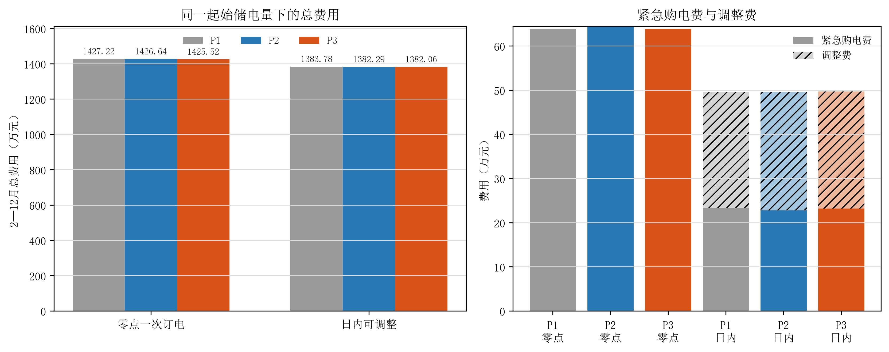
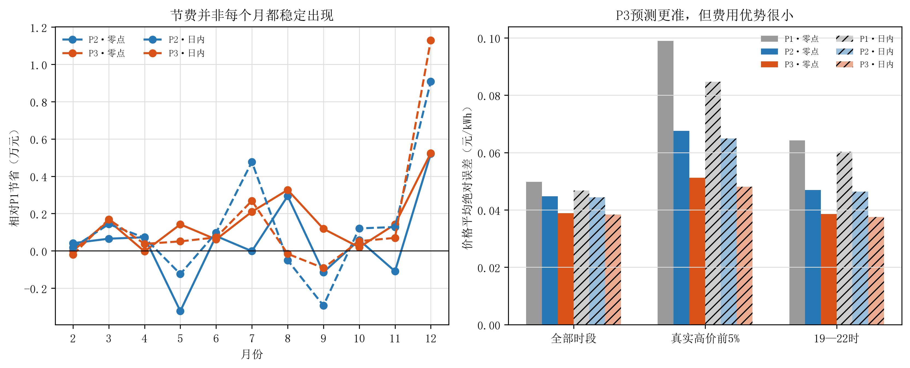

# 问题四前三种方案比较报告

## 1. 这次到底比较了什么

三种方案只在“怎样估计未来电价”上不同，后面的购电和储能安排使用同一套线性规划。方案1用过去四周同星期、同一时刻的电价中位数；方案2把典型日内曲线、近期同星期价格、最近一周价格、当前已经出现的价格偏差和可用的净负荷预测放进滚动岭回归；方案3使用相同信息训练提升树，让模型自己学习非线性关系。

问题四第二问每天零点只制定一次订单。问题四第三问允许在6、12、18点重算尚未执行的订单，并且调整始终相对零点原订单结算。三种方案都不知道未来真实电价，也没有提前读取未来实际负载和实际光伏。

正式比较覆盖2025年2月1日至12月31日，共334天。为避免1月份不同策略留下的储电量不同而影响结论，三种方案都从2月1日同一个8592.69 kWh储电量开始。此后各自连续运行，真实库存逐日承接。

## 2. 费用结果

### 2.1 每天零点一次订电

| 价格方案 | 普通购电费/元 | 紧急购电费/元 | 总费用/元 |
|---|---:|---:|---:|
| 方案1 | 13,633,853.72 | 638,345.75 | 14,272,199.47 |
| 方案2 | 13,621,614.48 | 644,752.70 | 14,266,367.18 |
| 方案3 | 13,616,344.81 | 638,831.59 | **14,255,176.40** |

方案2比简单历史基准省5832.29元，降幅0.041%。方案3又比方案2省11190.77元，降幅0.078%。方案3在334天中有177天比方案2便宜、157天更贵，说明它有总体优势，但不是每天都占优。方案3年末还比方案2多留下约1327.07 kWh电量，因此它的费用优势并不是靠多消耗电池换来的。

### 2.2 日内可以调整订单

| 价格方案 | 普通电量费/元 | 调整费/元 | 紧急购电费/元 | 总费用/元 |
|---|---:|---:|---:|---:|
| 方案1 | 13,341,901.67 | 262,417.35 | 233,526.30 | 13,837,845.32 |
| 方案2 | 13,327,163.05 | 268,515.82 | **227,222.48** | 13,822,901.35 |
| 方案3 | 13,323,711.79 | 265,079.52 | 231,836.81 | **13,820,628.12** |

方案2比方案1省14943.97元，降幅0.108%。方案3比方案2只再省2273.23元，降幅0.016%。方案3在165天更便宜、169天更贵，其中位日节省为-1.80元；它的全年小幅优势来自少数收益较大的日期，并不是稳定的小幅累积。

方案2的紧急购电量为38733.80 kWh，低于方案3的40116.12 kWh；发生紧急购电的天数也少2天。换句话说，方案3把总账压低了2273元左右，却多用了1382 kWh紧急电。由于紧急购电按五倍价格计费，这个风险差异值得在选主方案时单独考虑。

## 3. 价格预测是否更准

| 分支 | 方案1 MAE | 方案2 MAE | 方案3 MAE |
|---|---:|---:|---:|
| 零点一次订电 | 0.04984 | 0.04472 | **0.03884** |
| 日内可调整 | 0.04676 | 0.04442 | **0.03834** |

单位均为元/kWh。方案3不只在全部时段误差最低，在真实高价前5%和19—22时晚高峰也最准确。可是预测更准没有等比例变成更低的电费：日内分支中，方案3相对方案2的价格误差下降约13.7%，总费用只下降0.016%。原因是电价预测只影响“把购买和储电安排到哪里”，实际供需偏差、电池容量和功率、调整费以及五倍紧急购电仍会共同决定最后账单。

逐月结果也不是一边倒。零点分支中，方案3相对方案2有7个月省钱、4个月增费；日内分支中有5个月省钱、6个月增费。日内分支的方案3在7月比方案2多花约2087元，在12月少花约2213元。不能把全年总额的小差距写成“所有月份都稳定更好”。

## 4. 重点方案2为什么有解释性

方案2不是凭空给出一条价格曲线。它同时参考附件1的典型日内形状、过去四周同星期同刻价格、最近7天同刻中位数、上周同刻价格、日期和星期信息，以及当时合法得到的净负荷预测。日内调整时，再加入“今天已经出现的整体价格高低”和“刚发生的价格偏差”，让剩余时段跟着当天实际水平修正。

52次滚动拟合中，“过去四周同星期同刻”“最近7天同刻”和“上周同刻”的系数中位数在两个分支都保持为正。日内分支中，刚发生的价格偏差也始终保持正向：若刚才的价格比历史轮廓高，模型通常也会抬高近处时段的预测。这个方向符合数据中价格具有连续性和星期规律的观察。

这些历史曲线彼此相关，因此不能把某一个回归系数解释成单独的因果贡献。方案2的可靠解释应停留在结构层面：它用稳定日内形状定骨架，用近期和同星期历史判断价格水平，再用当天已发生信息修正近处预测。净负荷项在滚动拟合中的方向没有始终一致，所以不能在论文中夸大为稳定的价格决定因素。

## 5. 方案3为什么更准，但更难讲

方案3使用和方案2相同的合法信息，只是用提升树学习非线性组合。保存模型的分裂记录显示，两个分支中最主要的分裂依据都是过去四周同星期同刻价格和上周同刻价格；近期曲线、附件1骨架、净负荷和季节位置也有使用。这与附件4的星期周期规律一致。

分裂次数和分裂增益只能说明模型在什么地方切分数据，不能当成因果贡献。树模型还会让同一个变量在不同区间起不同作用，论文需要花更多篇幅解释。它适合证明“非线性预测还能把误差压低”，但未必值得为了0.016%的日内费用差距替换更容易说明的方案2。

## 6. 核验和结论边界

独立回读没有重新训练模型或重新求解，而是从保存结果重新核对六套策略。共检查2004个日策略、288576个实际运行区间、208个价格模型和5010条线性规划记录。逐段供需平衡、储电递推、上下限、充放电功率、日内已执行订单锁定和三类费用重算均通过，Decimal总账与保存结果差为0。

现有比较只说明2025年内按时间向前滚动时的表现。它没有证明下一年仍保持相同价格规律，也没有证明任何候选是所有可能方法中的全局最优。方案4的连续高价情景和风险权重没有运行。

## 7. 推荐

- 对零点一次订电分支，若严格以当前年度实际总费用为标准，推荐方案3。它比方案2少11190.77元，价格误差也更低，而且年末库存更高。
- 对日内可调整分支，推荐方案2作为主方案，方案3作为对照。方案3只少2273.23元，但紧急购电更多、过半月份没有优势，增加的解释成本不值得这0.016%的费用差距。
- 若希望两条分支在论文中完全统一，也可以都采用方案2，并如实报告方案3在费用上的小幅优势；这更容易讲清楚，但不能写成方案2费用最低。
- 方案4继续保留。只有在后续决定把连续高价风险作为问题四的主要深化方向时，才值得运行。

当前停在主方案选择处，没有填写result4、写问题四论文正文或冻结问题四。
